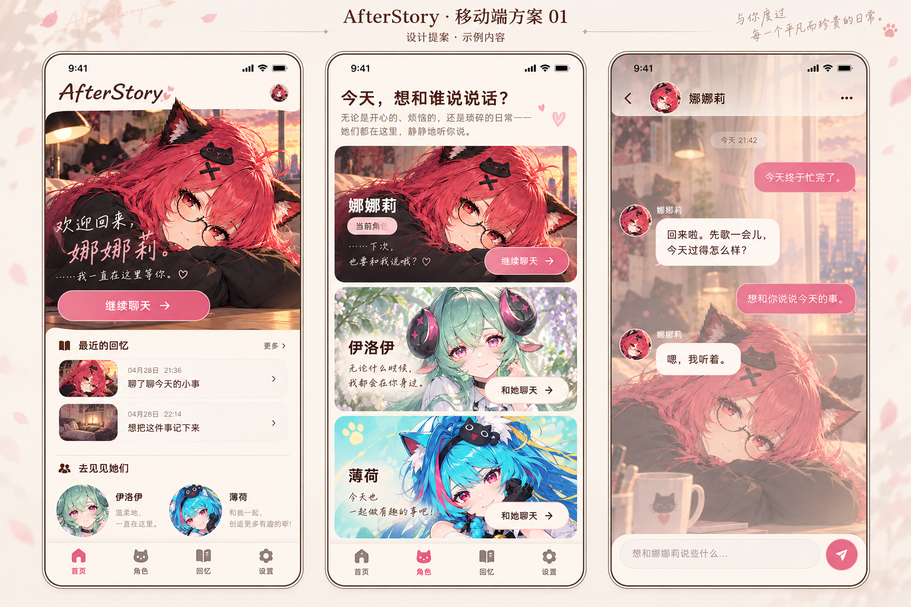
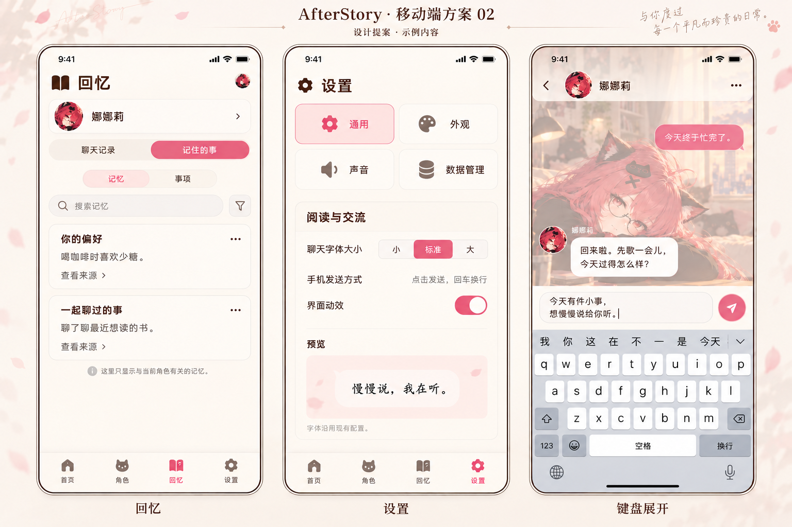

# 移动端最小适配 v1 · 集中评审

- 日期：2026-10-22。
- 状态：视觉方向已获认可，移动端 v1 已按方案实现；本目录两张图仍是概念效果图，线上页面由 Vue/CSS 实际渲染，服务器尚未更新。
- 2026-10-24 复查后，手机聊天已改为独立视图与竖屏场景素材，使用更紧凑的正文与浅色消息气泡；实际素材见 [`public/mobile-scenes/`](../../public/mobile-scenes/README.md)。本目录效果图继续作为氛围参考，不作为可直接复刻的字体或界面贴图。
- 完整交互、实施边界和验收：[方案文档](../../../docs/design/frontend/01-mobile-minimum.md)。
- 本轮交付两张生成式效果图，展示五个主要页面及一个聊天键盘状态；登录、注册、角色资料、封面编辑和异常状态的具体规则见方案，尚未逐个绘制高保真图。

## 01 首页、角色、聊天

- 首页先给出继续聊天入口，之后才是回忆与其他角色。
- 角色卡单列，使用现有娜娜莉、伊洛伊、薄荷素材；当前角色突出，不依赖鼠标悬停才能操作。
- 聊天独立一屏，仅保留顶部角色栏、消息和输入框；底部四项导航在此隐藏。

## 02 回忆、设置、键盘展开

- 回忆保留角色范围、历史/记忆、记忆/事项和来源入口，筛选收拢；实际字段与操作以既有能力为准。
- 设置以类别选择和单列内容呈现，不把桌面的双栏直接缩小。
- 设置保留现有通用/外观/声音/数据管理分类；声音仍未启用，字号仍为小/标准/大三档，不新增独立字体家族选择器。
- 键盘展开时缩小消息空间，输入区在键盘上方，顶部返回可见。

## 阅读效果图时的边界

1. 图为概念效果图，不是浏览器截图，不证明已完成响应式或实机键盘测试。
2. 图中日期、对话、偏好、记忆、签名和短句都是展示样例，不能导入正式用户数据或覆盖角色定义。正式文本继续读取项目已有配置。
3. AI 图中的字号、字形、间距和控件细节可能有偏差；实现以方案和现有功能为准。字体使用仓库现有依赖，不能为复刻生成字形再引入未知字体。
4. 手机背景使用原始项目素材和裁切规则，不能把包含整套手机界面的生成图当成网页背景。
5. 键盘由手机系统提供，图中键盘仅解释空间占用；应用不绘制键盘，也不接入语音功能。
6. 头像、记忆来源与更多等交互应至少有 44px 的触摸区域；图中小图标不代表真实热区大小。

## 待集中确认

- 普通页面底部四项导航，聊天页隐藏底栏，是否接受。
- 保留角色背景与字体、简化桌面层叠装饰，是否符合预期。
- 手机 Enter 换行、按钮发送，是否接受。
- 这组颜色、卡片密度与背景可见程度是否合适。

## 素材与生成记录

- 方式：内置 image_gen；没有使用 CLI、项目模型 API 或真实聊天接口。
- 图 01 提示词：[01-prompt.txt](01-prompt.txt)。参考：`背景/娜娜莉1.png`、`data/character-assets/iroi.png`、`data/character-assets/mint.png`。
- 图 02 提示词：[02-prompt.txt](02-prompt.txt)。参考：图 01 与 `背景/娜娜莉1.png`。
- 图 02 经一次准确性修订：[02-correction-prompt.txt](02-correction-prompt.txt)。修正生成稿中的字体选择器、设置类别和没有数据来源的记忆配图；以本目录最终图为准。
- 生成结果保存在本目录，原角色素材不修改。只供评审，尚未被运行中的页面引用。
