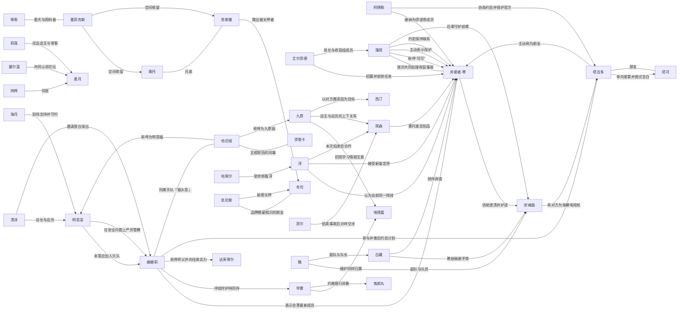

# Canon 人物关系图

> 派生审核视图；checkpoint：`nt-bv1kqoabievz-p08`（番外 某传奇乐队（吗？）的第一页）。Canon 人物关系不等于现实用户与角色实例的 Runtime Relationship。

| 关系 | 类别 | 说明 | 证据 |
| --- | --- | --- | --- |
| 艾尔菲德 → 异能者·零：招募并安排任务 | organizational | 艾尔菲德代表管理局与异能者·零建立合作契约，并安排其参与零号异象收容及在伊波恩落脚。 | [nt-bv1kqoabievz-p01-e015](https://www.bilibili.com/video/BV1kqoaBiEVZ/?p=1&t=966)、[nt-bv1kqoabievz-p01-e016](https://www.bilibili.com/video/BV1kqoaBiEVZ/?p=1&t=1109) |
| 薄荷 ↔ 异能者·零：首次共同处理收容事故 | cooperative | 薄荷与异能者·零共同寻找R-3707的奇点并完成处置。 | [nt-bv1kqoabievz-p01-e018](https://www.bilibili.com/video/BV1kqoaBiEVZ/?p=1&t=1220)、[nt-bv1kqoabievz-p01-e024](https://www.bilibili.com/video/BV1kqoaBiEVZ/?p=1&t=1654)、[nt-bv1kqoabievz-p01-e026](https://www.bilibili.com/video/BV1kqoaBiEVZ/?p=1&t=1898) |
| 薄荷 → 异能者·零：称呼“可可” | social | 薄荷按闻到的香味给人取称呼，并将异能者·零称为“可可”。 | [nt-bv1kqoabievz-p01-e014](https://www.bilibili.com/video/BV1kqoaBiEVZ/?p=1&t=867) |
| 薄荷 → 异能者·零：主动表示保护 | protective | 第一次共同执行收容任务时，薄荷主动表示会保护异能者·零，并在交战中提醒其避险。 | [nt-bv1kqoabievz-p01-e018](https://www.bilibili.com/video/BV1kqoaBiEVZ/?p=1&t=1220)、[nt-bv1kqoabievz-p01-e025](https://www.bilibili.com/video/BV1kqoaBiEVZ/?p=1&t=1860) |
| 浔 → 异能者·零：认为当前同一阵线 | cooperative | 面对艾尔菲德的担忧，浔认为异能者·零虽然特殊，但至少当前与管理局站在一起。 | [nt-bv1kqoabievz-p01-e028](https://www.bilibili.com/video/BV1kqoaBiEVZ/?p=1&t=2025) |
| 艾尔菲德 → 薄荷：局长与收容组成员 | organizational | 艾尔菲德向薄荷下达重新收容R-3707及护送异能者·零前往伊波恩的任务。 | [nt-bv1kqoabievz-p01-e017](https://www.bilibili.com/video/BV1kqoaBiEVZ/?p=1&t=1149)、[nt-bv1kqoabievz-p01-e027](https://www.bilibili.com/video/BV1kqoaBiEVZ/?p=1&t=1968) |
| 阿德勒 → 异能者·零：接纳为伊波恩成员 | organizational | 阿德勒为异能者·零安排住处和生活用品，并正式欢迎他成为伊波恩的一员。 | [nt-bv1kqoabievz-p02-e009](https://www.bilibili.com/video/BV1kqoaBiEVZ/?p=2&t=1099)、[nt-bv1kqoabievz-p02-e010](https://www.bilibili.com/video/BV1kqoaBiEVZ/?p=2&t=1303) |
| 浔 → 异能者·零：接受新鉴定师 | organizational | 浔接受异能者·零作为伊波恩的鉴定师，并把他的到来视为店铺转机。 | [nt-bv1kqoabievz-p02-e008](https://www.bilibili.com/video/BV1kqoaBiEVZ/?p=2&t=927)、[nt-bv1kqoabievz-p02-e020](https://www.bilibili.com/video/BV1kqoaBiEVZ/?p=2&t=3773) |
| 塔吉多 → 异能者·零：主动称为朋友 | social | 塔吉多得知异能者·零能理解自己的话后，立即表示喜欢鉴定师并把他当作朋友。 | [nt-bv1kqoabievz-p02-e006](https://www.bilibili.com/video/BV1kqoaBiEVZ/?p=2&t=535) |
| 薄荷 → 异能者·零：约定保持联系 | social | 薄荷护送异能者·零到伊波恩后，嘱咐同伴照顾他并请他常与自己联系。 | [nt-bv1kqoabievz-p02-e009](https://www.bilibili.com/video/BV1kqoaBiEVZ/?p=2&t=1099) |
| 娜娜莉 → 异能者·零：表示会罩着新成员 | protective | 初次见面时娜娜莉主动表示以后会罩着异能者·零。 | [nt-bv1kqoabievz-p02-e008](https://www.bilibili.com/video/BV1kqoaBiEVZ/?p=2&t=927) |
| 奥托 ↔ 弥斯墨：兄弟 | family | 弥斯墨称奥托为「我哥」；漫画作者将当铺接待者描述为双生兄弟。 | [nt-bv1kqoabievz-p03-e012](https://www.bilibili.com/video/BV1kqoaBiEVZ/?p=3&t=2192)、[nt-bv1kqoabievz-p03-e021](https://www.bilibili.com/video/BV1kqoaBiEVZ/?p=3&t=4246)、[nt-bv1kqoabievz-p03-e023](https://www.bilibili.com/video/BV1kqoaBiEVZ/?p=3&t=5058) |
| 凯尼斯 ↔ 冬司：品牌晚宴相识的朋友 | social | 冬司称两人相识于品牌晚宴，并将凯尼斯称为一位朋友；其后出现绑架冲突，不能把这层称呼解读为目前仍互相信任。 | [nt-bv1kqoabievz-p03-e021](https://www.bilibili.com/video/BV1kqoaBiEVZ/?p=3&t=4246) |
| 凯尼斯 → 冬司：秘密关押 | adversarial | 冬司说明凯尼斯误以为其已使用香炉，担心自己反悔夺回代价的打算泄露，将冬司秘密关押。 | [nt-bv1kqoabievz-p03-e018](https://www.bilibili.com/video/BV1kqoaBiEVZ/?p=3&t=3462)、[nt-bv1kqoabievz-p03-e021](https://www.bilibili.com/video/BV1kqoaBiEVZ/?p=3&t=4246) |
| 弥斯墨 → 冬司：救出被关押者 | protective | 冬司感谢弥斯墨搭救；弥斯墨表示是因冬司的代价未到账而外出确认。救援事实不等于与冬司建立长期亲密关系。 | [nt-bv1kqoabievz-p03-e021](https://www.bilibili.com/video/BV1kqoaBiEVZ/?p=3&t=4246) |
| 九原 → 埃德嘉：招揽学习情报生意 | organizational | 九原询问埃德嘉是否考虑跟自己学习这门生意，早雾当场反对；不表明埃德嘉接受邀请或离开伊波恩。 | [nt-bv1kqoabievz-p03-e008](https://www.bilibili.com/video/BV1kqoaBiEVZ/?p=3&t=1436) |
| 早雾 → 埃德嘉：维护同伴归属 | protective | 面对九原的招揽，早雾明确说埃德嘉不会离开伊波恩，并要求九原不要再打他的主意。 | [nt-bv1kqoabievz-p03-e008](https://www.bilibili.com/video/BV1kqoaBiEVZ/?p=3&t=1436) |
| 娜娜莉 → 早雾：冲突时护持同伴 | protective | 娜娜莉担心早雾独自吃亏，见到其与当铺接待者冲突便上前要求对方不准欺负早雾；随后听取埃德嘉对现场的澄清。 | [nt-bv1kqoabievz-p03-e020](https://www.bilibili.com/video/BV1kqoaBiEVZ/?p=3&t=4106) |
| 娜娜莉 → 达芙蒂尔：称呼师父并向往其实力 | social | 娜娜莉在许愿时称达芙蒂尔为师父，希望变得和她一样厉害；只记录称呼与敬慕，不确定正式师徒安排。 | [nt-bv1kqoabievz-p03-e016](https://www.bilibili.com/video/BV1kqoaBiEVZ/?p=3&t=2790) |
| 嘭嘭 ↔ 墨菲克斯：爱犬与照料者 | other | 嘭嘭自述将蒲公英捡回家并长期照料，走失后持续寻找；本番外两者重逢，奥托明确说明蒲公英就是墨菲克斯。 | [nt-bv1kqoabievz-p03-e011](https://www.bilibili.com/video/BV1kqoaBiEVZ/?p=3&t=2028)、[nt-bv1kqoabievz-p03-e013](https://www.bilibili.com/video/BV1kqoaBiEVZ/?p=3&t=2405)、[nt-bv1kqoabievz-p03-e022](https://www.bilibili.com/video/BV1kqoaBiEVZ/?p=3&t=4645)、[nt-bv1kqoabievz-p03-e023](https://www.bilibili.com/video/BV1kqoaBiEVZ/?p=3&t=5058) |
| 墨菲克斯 → 奥托：空间收留 | cooperative | 奥托说明蒲公英收留他与弥斯墨，允许二人暂时使用自己的空间；奥托感谢这半年多的陪伴。 | [nt-bv1kqoabievz-p03-e022](https://www.bilibili.com/video/BV1kqoaBiEVZ/?p=3&t=4645)、[nt-bv1kqoabievz-p03-e023](https://www.bilibili.com/video/BV1kqoaBiEVZ/?p=3&t=5058) |
| 墨菲克斯 → 弥斯墨：空间收留 | cooperative | 奥托说明蒲公英收留兄弟二人；嘭嘭感谢他们照料蒲公英，弥斯墨在分别时提醒主人看紧它。 | [nt-bv1kqoabievz-p03-e022](https://www.bilibili.com/video/BV1kqoaBiEVZ/?p=3&t=4645)、[nt-bv1kqoabievz-p03-e023](https://www.bilibili.com/video/BV1kqoaBiEVZ/?p=3&t=5058) |
| 早雾 → 鬼郎丸：约束随行异象 | other | 早雾在本次调查中命令鬼郎丸不准乱吃、盯紧门、吐出吞下物件并禁食；后续冲突中鬼郎丸询问吞食对手需其批准。仅支持本次指令关系。 | [nt-bv1kqoabievz-p03-e010](https://www.bilibili.com/video/BV1kqoaBiEVZ/?p=3&t=1856)、[nt-bv1kqoabievz-p03-e014](https://www.bilibili.com/video/BV1kqoaBiEVZ/?p=3&t=2476)、[nt-bv1kqoabievz-p03-e020](https://www.bilibili.com/video/BV1kqoaBiEVZ/?p=3&t=4106) |
| 塔吉多 → 塔可：单向爱慕并尝试告白 | romantic | 塔吉多对塔可抱有明确爱慕，为她准备约会、礼物和告白表演。告白没有完成，不据此推断塔可接受恋爱关系。 | [nt-bv1kqoabievz-p04-e001](https://www.bilibili.com/video/BV1kqoaBiEVZ/?p=4&t=19)、[nt-bv1kqoabievz-p04-e004](https://www.bilibili.com/video/BV1kqoaBiEVZ/?p=4&t=292)、[nt-bv1kqoabievz-p04-e019](https://www.bilibili.com/video/BV1kqoaBiEVZ/?p=4&t=2983)、[nt-bv1kqoabievz-p04-e020](https://www.bilibili.com/video/BV1kqoaBiEVZ/?p=4&t=3370) |
| 塔吉多 ↔ 塔可：朋友 | social | 塔吉多明确接受告白未成功后仍是朋友；塔可搬走后寄来明信片并感谢这次经历。 | [nt-bv1kqoabievz-p04-e022](https://www.bilibili.com/video/BV1kqoaBiEVZ/?p=4&t=3667) |
| 阿德勒 → 塔吉多：协助约会并保护双方 | cooperative | 阿德勒帮助塔吉多准备约会，同时提醒公开告白可能给塔可压力，并预留保护双方感受的应变方案。 | [nt-bv1kqoabievz-p04-e004](https://www.bilibili.com/video/BV1kqoaBiEVZ/?p=4&t=292)、[nt-bv1kqoabievz-p04-e013](https://www.bilibili.com/video/BV1kqoaBiEVZ/?p=4&t=2245)、[nt-bv1kqoabievz-p04-e019](https://www.bilibili.com/video/BV1kqoaBiEVZ/?p=4&t=2983) |
| 娜娜莉 → 塔吉多：参与并善后约会计划 | cooperative | 娜娜莉加入排练、运送材料、参与表演，并在事故后与大家一起清理现场。 | [nt-bv1kqoabievz-p04-e006](https://www.bilibili.com/video/BV1kqoaBiEVZ/?p=4&t=1411)、[nt-bv1kqoabievz-p04-e016](https://www.bilibili.com/video/BV1kqoaBiEVZ/?p=4&t=2638)、[nt-bv1kqoabievz-p04-e019](https://www.bilibili.com/video/BV1kqoaBiEVZ/?p=4&t=2983)、[nt-bv1kqoabievz-p04-e022](https://www.bilibili.com/video/BV1kqoaBiEVZ/?p=4&t=3667) |
| 简森 → 异能者·零：委托鉴定拍品 | cooperative | 简森以报酬换取伊波恩鉴定师出席拍卖会并辨别压轴拍品真伪。 | [nt-bv1kqoabievz-p05-e003](https://www.bilibili.com/video/BV1kqoaBiEVZ/?p=5&t=170)、[nt-bv1kqoabievz-p05-e008](https://www.bilibili.com/video/BV1kqoaBiEVZ/?p=5&t=565) |
| 九原 → 简森：店主与店员的上下关系 | organizational | 九原在斯特利速递任职并执行简森安排的拍卖会委托。 | [nt-bv1kqoabievz-p05-e007](https://www.bilibili.com/video/BV1kqoaBiEVZ/?p=5&t=494) |
| 哈尼娅 ↔ 伊里卡：互相较劲的同事 | social | 哈尼娅与伊里卡常在竞速记录与专业度上互不服气，但同属斯特利速递。 | [nt-bv1kqoabievz-p05-e007](https://www.bilibili.com/video/BV1kqoaBiEVZ/?p=5&t=494)、[nt-bv1kqoabievz-p05-e036](https://www.bilibili.com/video/BV1kqoaBiEVZ/?p=5&t=5018) |
| 哈尼娅 → 九原：称呼为九原姐 | social | 哈尼娅以「九原姐」称呼九原。 | [nt-bv1kqoabievz-p05-e036](https://www.bilibili.com/video/BV1kqoaBiEVZ/?p=5&t=5018) |
| 哈尼娅 → 明音凛：称呼为明音姐 | social | 哈尼娅以「明音姐」称呼明音，并常去 StarSign 看演出。 | [nt-bv1kqoabievz-p08-e003b](https://www.bilibili.com/video/BV1kqoaBiEVZ/?p=8&t=243)、[nt-bv1kqoabievz-p08-e004a](https://www.bilibili.com/video/BV1kqoaBiEVZ/?p=8&t=334) |
| 哈索尔 → 浔：受命照看浔 | protective | 哈索尔在拍卖会现场表示会照看浔，让鉴定师专注委托。 | [nt-bv1kqoabievz-p05-e024](https://www.bilibili.com/video/BV1kqoaBiEVZ/?p=5&t=2856) |
| 浔 → 简森：本次拍卖会合作 | cooperative | 浔以被邀请者同行身份与简森合作参与惠比寿拍卖会。 | [nt-bv1kqoabievz-p05-e004](https://www.bilibili.com/video/BV1kqoaBiEVZ/?p=5&t=280)、[nt-bv1kqoabievz-p05-e041](https://www.bilibili.com/video/BV1kqoaBiEVZ/?p=5&t=6073) |
| 菲尔 → 简森：拍卖事故后对峙交涉 | adversarial | 菲尔以伪造邀请函与事故为由要求斯特利一行人配合调查。 | [nt-bv1kqoabievz-p05-e039](https://www.bilibili.com/video/BV1kqoaBiEVZ/?p=5&t=5821) |
| 九原 → 西汀：以对方邀请函为目标 | other | 九原与鉴定师接近歌手西汀，以其随身邀请函完成契约替换。 | [nt-bv1kqoabievz-p05-e016](https://www.bilibili.com/video/BV1kqoaBiEVZ/?p=5&t=1497)、[nt-bv1kqoabievz-p05-e017](https://www.bilibili.com/video/BV1kqoaBiEVZ/?p=5&t=1645) |
| 薄荷 → 安魂曲：后辈守护前辈 | protective | 薄荷在休假期间组织守护行动，替安魂曲挡住谣言造成的伤害。 | [nt-bv1kqoabievz-p06-e009a](https://www.bilibili.com/video/BV1kqoaBiEVZ/?p=6&t=589)、[nt-bv1kqoabievz-p06-e015b](https://www.bilibili.com/video/BV1kqoaBiEVZ/?p=6&t=1012) |
| 安魂曲 → 塔吉多：称对方为海獭电视机 | social | 安魂曲把塔吉多称作「海獭电视机」。 | [nt-bv1kqoabievz-p06-e010b](https://www.bilibili.com/video/BV1kqoaBiEVZ/?p=6&t=634) |
| 异能者·零 → 安魂曲：协助澄清并护送 | cooperative | 鉴定师与塔吉多协助安魂曲澄清谣言并护送她回家。 | [nt-bv1kqoabievz-p06-e015c](https://www.bilibili.com/video/BV1kqoaBiEVZ/?p=6&t=1012)、[nt-bv1kqoabievz-p06-e021b](https://www.bilibili.com/video/BV1kqoaBiEVZ/?p=6&t=1471) |
| 翳 → 安魂曲：副队与队员 | organizational | 翳到场接安魂曲，并替队员向众人致谢、承担收尾。 | [nt-bv1kqoabievz-p06-e034a](https://www.bilibili.com/video/BV1kqoaBiEVZ/?p=6&t=2694) |
| 白藏 → 安魂曲：教她致谢手势 | social | 白藏与法帝娅教安魂曲用夸张手势表达最真诚的感谢。 | [nt-bv1kqoabievz-p06-e035a](https://www.bilibili.com/video/BV1kqoaBiEVZ/?p=6&t=2764) |
| 炜桦 → 麦月：邻居 | social | 炜桦是麦月家邻居，向鉴定师讲述麦月的语言障碍与平日表现。 | [nt-bv1kqoabievz-p07-e005](https://www.bilibili.com/video/BV1kqoaBiEVZ/?p=7&t=486) |
| 塞尔温 → 麦月：共同认领花坛 | social | 塞尔温与麦月共同认领街区花坛，麦月负责植物介绍卡。 | [nt-bv1kqoabievz-p07-e006](https://www.bilibili.com/video/BV1kqoaBiEVZ/?p=7&t=606) |
| 莉莲 → 麦月：花店店主与常客 | social | 莉莲的花店是麦月每周固定光顾的地方，麦月以比划挑选花种。 | [nt-bv1kqoabievz-p07-e009](https://www.bilibili.com/video/BV1kqoaBiEVZ/?p=7&t=1041) |
| 白藏 → 异能者·零：结伴调查 | cooperative | 白藏主动提出与鉴定师结伴调查麦月失踪案，并提供手语帮助。 | [nt-bv1kqoabievz-p07-e008](https://www.bilibili.com/video/BV1kqoaBiEVZ/?p=7&t=885)、[nt-bv1kqoabievz-p07-e017](https://www.bilibili.com/video/BV1kqoaBiEVZ/?p=7&t=2032) |
| 翳 → 白藏：副队与队长 | organizational | 翳查找翘班的白藏队长，并在庄园事件中负责指挥与收尾。 | [nt-bv1kqoabievz-p07-e010](https://www.bilibili.com/video/BV1kqoaBiEVZ/?p=7&t=1150)、[nt-bv1kqoabievz-p07-e016](https://www.bilibili.com/video/BV1kqoaBiEVZ/?p=7&t=1877) |
| 清泽 → 明音凛：店长与店员 | organizational | 清泽是 StarSign 店长，明音在店内吧台工作。 | [nt-bv1kqoabievz-p08-e005a](https://www.bilibili.com/video/BV1kqoaBiEVZ/?p=8&t=432) |
| 清泽 → 娜娜莉：邀请登台演出 | cooperative | 清泽邀请娜娜莉与哈尼娅为店内演出做暖场，并提供练习场地。 | [nt-bv1kqoabievz-p08-e020a](https://www.bilibili.com/video/BV1kqoaBiEVZ/?p=8&t=2225)、[nt-bv1kqoabievz-p08-e042b](https://www.bilibili.com/video/BV1kqoaBiEVZ/?p=8&t=4887) |
| 娜娜莉 ↔ 哈尼娅：同属乐队「猫头音」 | cooperative | 娜娜莉与哈尼娅结成乐队「猫头音」，一起练习并参加月亮狗之夜。 | [nt-bv1kqoabievz-p08-e032a](https://www.bilibili.com/video/BV1kqoaBiEVZ/?p=8&t=3762)、[nt-bv1kqoabievz-p08-e043](https://www.bilibili.com/video/BV1kqoaBiEVZ/?p=8&t=4997) |
| 明音凛 → 娜娜莉：未答应加入乐队 | other | 明音表示自己没答应加入「猫头音」，只是被拉进群组。 | [nt-bv1kqoabievz-p08-e032b](https://www.bilibili.com/video/BV1kqoaBiEVZ/?p=8&t=3835) |
| 明音凛 → 娜娜莉：在安全问题上严厉管教 | protective | 娜娜莉与哈尼娅拿异象做实验时，明音厉声制止并要求她们对自己的演奏负责。 | [nt-bv1kqoabievz-p08-e036b](https://www.bilibili.com/video/BV1kqoaBiEVZ/?p=8&t=4236)、[nt-bv1kqoabievz-p08-e039a](https://www.bilibili.com/video/BV1kqoaBiEVZ/?p=8&t=4558) |
| 海月 → 明音凛：到场支持并守约 | cooperative | 海月每场都到现场看明音登台，并提起解散那天在下一个舞台等她的约定。 | [nt-bv1kqoabievz-p08-e045](https://www.bilibili.com/video/BV1kqoaBiEVZ/?p=8&t=5388) |
