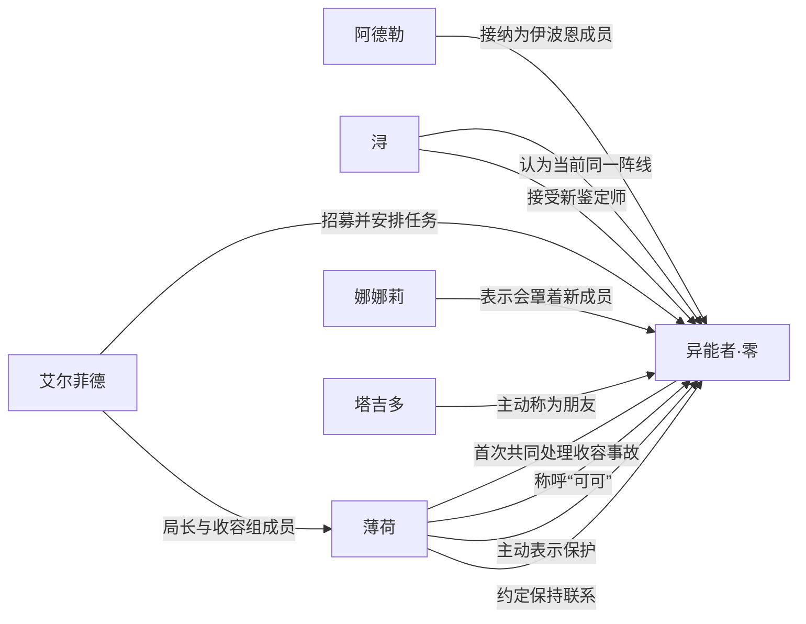

# Canon 人物关系图

> 派生审核视图；checkpoint：`nt-bv1kqoabievz-p02`（第1话 生意经与招财宝）。Canon 人物关系不等于现实用户与角色实例的 Runtime Relationship。

| 关系 | 类别 | 说明 | 证据 |
| --- | --- | --- | --- |
| 艾尔菲德 → 异能者·零：招募并安排任务 | organizational | 艾尔菲德代表管理局与异能者·零建立合作契约，并安排其参与零号异象收容及在伊波恩落脚。 | [nt-bv1kqoabievz-p01-e015](https://www.bilibili.com/video/BV1kqoaBiEVZ/?p=1&t=966)、[nt-bv1kqoabievz-p01-e016](https://www.bilibili.com/video/BV1kqoaBiEVZ/?p=1&t=1109) |
| 薄荷 ↔ 异能者·零：首次共同处理收容事故 | cooperative | 薄荷与异能者·零共同寻找R-3707的奇点并完成处置。 | [nt-bv1kqoabievz-p01-e018](https://www.bilibili.com/video/BV1kqoaBiEVZ/?p=1&t=1220)、[nt-bv1kqoabievz-p01-e024](https://www.bilibili.com/video/BV1kqoaBiEVZ/?p=1&t=1654)、[nt-bv1kqoabievz-p01-e026](https://www.bilibili.com/video/BV1kqoaBiEVZ/?p=1&t=1898) |
| 薄荷 → 异能者·零：称呼“可可” | social | 薄荷按闻到的香味给人取称呼，并将异能者·零称为“可可”。 | [nt-bv1kqoabievz-p01-e014](https://www.bilibili.com/video/BV1kqoaBiEVZ/?p=1&t=867) |
| 薄荷 → 异能者·零：主动表示保护 | protective | 第一次共同执行收容任务时，薄荷主动表示会保护异能者·零，并在交战中提醒其避险。 | [nt-bv1kqoabievz-p01-e018](https://www.bilibili.com/video/BV1kqoaBiEVZ/?p=1&t=1220)、[nt-bv1kqoabievz-p01-e025](https://www.bilibili.com/video/BV1kqoaBiEVZ/?p=1&t=1860) |
| 浔 → 异能者·零：认为当前同一阵线 | cooperative | 面对艾尔菲德的担忧，浔认为异能者·零虽然特殊，但至少当前与管理局站在一起。 | [nt-bv1kqoabievz-p01-e028](https://www.bilibili.com/video/BV1kqoaBiEVZ/?p=1&t=2025) |
| 艾尔菲德 → 薄荷：局长与收容组成员 | organizational | 艾尔菲德向薄荷下达重新收容R-3707及护送异能者·零前往伊波恩的任务。 | [nt-bv1kqoabievz-p01-e017](https://www.bilibili.com/video/BV1kqoaBiEVZ/?p=1&t=1149)、[nt-bv1kqoabievz-p01-e027](https://www.bilibili.com/video/BV1kqoaBiEVZ/?p=1&t=1968) |
| 阿德勒 → 异能者·零：接纳为伊波恩成员 | organizational | 阿德勒为异能者·零安排住处和生活用品，并正式欢迎他成为伊波恩的一员。 | [nt-bv1kqoabievz-p02-e009](https://www.bilibili.com/video/BV1kqoaBiEVZ/?p=2&t=1099)、[nt-bv1kqoabievz-p02-e010](https://www.bilibili.com/video/BV1kqoaBiEVZ/?p=2&t=1303) |
| 浔 → 异能者·零：接受新鉴定师 | organizational | 浔接受异能者·零作为伊波恩的鉴定师，并把他的到来视为店铺转机。 | [nt-bv1kqoabievz-p02-e008](https://www.bilibili.com/video/BV1kqoaBiEVZ/?p=2&t=927)、[nt-bv1kqoabievz-p02-e020](https://www.bilibili.com/video/BV1kqoaBiEVZ/?p=2&t=3773) |
| 塔吉多 → 异能者·零：主动称为朋友 | social | 塔吉多得知异能者·零能理解自己的话后，立即表示喜欢鉴定师并把他当作朋友。 | [nt-bv1kqoabievz-p02-e006](https://www.bilibili.com/video/BV1kqoaBiEVZ/?p=2&t=535) |
| 薄荷 → 异能者·零：约定保持联系 | social | 薄荷护送异能者·零到伊波恩后，嘱咐同伴照顾他并请他常与自己联系。 | [nt-bv1kqoabievz-p02-e009](https://www.bilibili.com/video/BV1kqoaBiEVZ/?p=2&t=1099) |
| 娜娜莉 → 异能者·零：表示会罩着新成员 | protective | 初次见面时娜娜莉主动表示以后会罩着异能者·零。 | [nt-bv1kqoabievz-p02-e008](https://www.bilibili.com/video/BV1kqoaBiEVZ/?p=2&t=927) |
