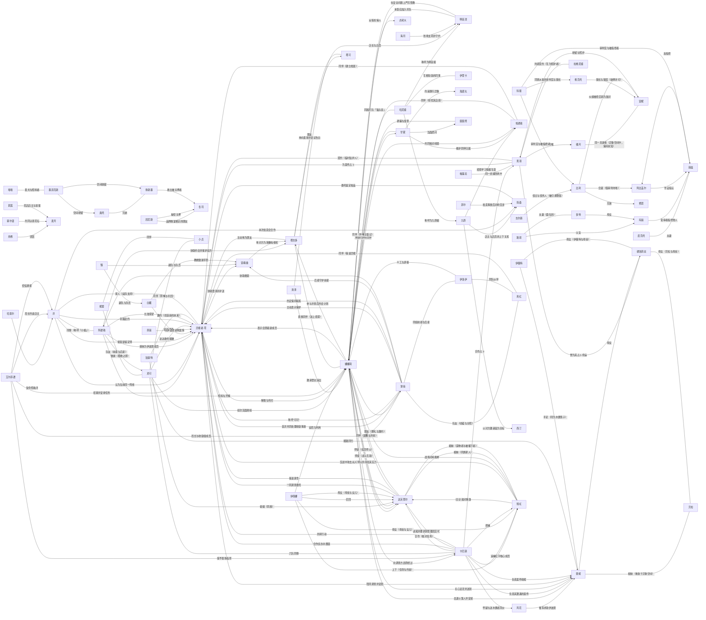

# Canon 人物关系图

> 派生审核视图；checkpoint：`nt-bv1kqoabievz-p22`（第8话 魔女 4）。Canon 人物关系不等于现实用户与角色实例的 Runtime Relationship。

| 关系 | 类别 | 说明 | 证据 |
| --- | --- | --- | --- |
| 艾尔菲德 → 异能者·零：招募并安排任务 | organizational | 艾尔菲德代表管理局与异能者·零建立合作契约，并安排其参与零号异象收容及在伊波恩落脚。 | [nt-bv1kqoabievz-p01-e015](https://www.bilibili.com/video/BV1kqoaBiEVZ/?p=1&t=966)、[nt-bv1kqoabievz-p01-e016](https://www.bilibili.com/video/BV1kqoaBiEVZ/?p=1&t=1109) |
| 薄荷 ↔ 异能者·零：首次共同处理收容事故 | cooperative | 薄荷与异能者·零共同寻找R-3707的奇点并完成处置。 | [nt-bv1kqoabievz-p01-e018](https://www.bilibili.com/video/BV1kqoaBiEVZ/?p=1&t=1220)、[nt-bv1kqoabievz-p01-e024](https://www.bilibili.com/video/BV1kqoaBiEVZ/?p=1&t=1654)、[nt-bv1kqoabievz-p01-e026](https://www.bilibili.com/video/BV1kqoaBiEVZ/?p=1&t=1898) |
| 薄荷 → 异能者·零：称呼“可可” | social | 薄荷按闻到的香味给人取称呼，并将异能者·零称为“可可”。 | [nt-bv1kqoabievz-p01-e014](https://www.bilibili.com/video/BV1kqoaBiEVZ/?p=1&t=867) |
| 薄荷 → 异能者·零：主动表示保护 | protective | 第一次共同执行收容任务时，薄荷主动表示会保护异能者·零，并在交战中提醒其避险。 | [nt-bv1kqoabievz-p01-e018](https://www.bilibili.com/video/BV1kqoaBiEVZ/?p=1&t=1220)、[nt-bv1kqoabievz-p01-e025](https://www.bilibili.com/video/BV1kqoaBiEVZ/?p=1&t=1860) |
| 浔 → 异能者·零：认为当前同一阵线 | cooperative | 面对艾尔菲德的担忧，浔认为异能者·零虽然特殊，但至少当前与管理局站在一起。 | [nt-bv1kqoabievz-p01-e028](https://www.bilibili.com/video/BV1kqoaBiEVZ/?p=1&t=2025) |
| 艾尔菲德 → 薄荷：局长与收容组成员 | organizational | 艾尔菲德向薄荷下达重新收容R-3707及护送异能者·零前往伊波恩的任务。 | [nt-bv1kqoabievz-p01-e017](https://www.bilibili.com/video/BV1kqoaBiEVZ/?p=1&t=1149)、[nt-bv1kqoabievz-p01-e027](https://www.bilibili.com/video/BV1kqoaBiEVZ/?p=1&t=1968) |
| 阿德勒 → 异能者·零：接纳为伊波恩成员 | organizational | 阿德勒为异能者·零安排住处和生活用品，并正式欢迎他成为伊波恩的一员。 | [nt-bv1kqoabievz-p02-e009](https://www.bilibili.com/video/BV1kqoaBiEVZ/?p=2&t=1099)、[nt-bv1kqoabievz-p02-e010](https://www.bilibili.com/video/BV1kqoaBiEVZ/?p=2&t=1303) |
| 浔 → 异能者·零：接受新鉴定师 | organizational | 浔接受异能者·零作为伊波恩的鉴定师，并把他的到来视为店铺转机。 | [nt-bv1kqoabievz-p02-e008](https://www.bilibili.com/video/BV1kqoaBiEVZ/?p=2&t=927)、[nt-bv1kqoabievz-p02-e020](https://www.bilibili.com/video/BV1kqoaBiEVZ/?p=2&t=3773) |
| 塔吉多 → 异能者·零：主动称为朋友 | social | 塔吉多得知异能者·零能理解自己的话后，立即表示喜欢鉴定师并把他当作朋友。 | [nt-bv1kqoabievz-p02-e006](https://www.bilibili.com/video/BV1kqoaBiEVZ/?p=2&t=535) |
| 薄荷 → 异能者·零：约定保持联系 | social | 薄荷护送异能者·零到伊波恩后，嘱咐同伴照顾他并请他常与自己联系。 | [nt-bv1kqoabievz-p02-e009](https://www.bilibili.com/video/BV1kqoaBiEVZ/?p=2&t=1099) |
| 娜娜莉 → 异能者·零：表示会罩着新成员 | protective | 初次见面时娜娜莉主动表示以后会罩着异能者·零。 | [nt-bv1kqoabievz-p02-e008](https://www.bilibili.com/video/BV1kqoaBiEVZ/?p=2&t=927) |
| 奥托 ↔ 弥斯墨：兄弟 | family | 弥斯墨称奥托为「我哥」；漫画作者将当铺接待者描述为双生兄弟。 | [nt-bv1kqoabievz-p03-e012](https://www.bilibili.com/video/BV1kqoaBiEVZ/?p=3&t=2192)、[nt-bv1kqoabievz-p03-e021](https://www.bilibili.com/video/BV1kqoaBiEVZ/?p=3&t=4246)、[nt-bv1kqoabievz-p03-e023](https://www.bilibili.com/video/BV1kqoaBiEVZ/?p=3&t=5058) |
| 凯尼斯 ↔ 冬司：品牌晚宴相识的朋友 | social | 冬司称两人相识于品牌晚宴，并将凯尼斯称为一位朋友；其后出现绑架冲突，不能把这层称呼解读为目前仍互相信任。 | [nt-bv1kqoabievz-p03-e021](https://www.bilibili.com/video/BV1kqoaBiEVZ/?p=3&t=4246) |
| 凯尼斯 → 冬司：秘密关押 | adversarial | 冬司说明凯尼斯误以为其已使用香炉，担心自己反悔夺回代价的打算泄露，将冬司秘密关押。 | [nt-bv1kqoabievz-p03-e018](https://www.bilibili.com/video/BV1kqoaBiEVZ/?p=3&t=3462)、[nt-bv1kqoabievz-p03-e021](https://www.bilibili.com/video/BV1kqoaBiEVZ/?p=3&t=4246) |
| 弥斯墨 → 冬司：救出被关押者 | protective | 冬司感谢弥斯墨搭救；弥斯墨表示是因冬司的代价未到账而外出确认。救援事实不等于与冬司建立长期亲密关系。 | [nt-bv1kqoabievz-p03-e021](https://www.bilibili.com/video/BV1kqoaBiEVZ/?p=3&t=4246) |
| 九原 → 埃德嘉：招揽学习情报生意 | organizational | 九原询问埃德嘉是否考虑跟自己学习这门生意，早雾当场反对；不表明埃德嘉接受邀请或离开伊波恩。 | [nt-bv1kqoabievz-p03-e008](https://www.bilibili.com/video/BV1kqoaBiEVZ/?p=3&t=1436) |
| 早雾 → 埃德嘉：维护同伴归属 | protective | 面对九原的招揽，早雾明确说埃德嘉不会离开伊波恩，并要求九原不要再打他的主意。 | [nt-bv1kqoabievz-p03-e008](https://www.bilibili.com/video/BV1kqoaBiEVZ/?p=3&t=1436) |
| 娜娜莉 → 早雾：冲突时护持同伴 | protective | 娜娜莉担心早雾独自吃亏，见到其与当铺接待者冲突便上前要求对方不准欺负早雾；随后听取埃德嘉对现场的澄清。 | [nt-bv1kqoabievz-p03-e020](https://www.bilibili.com/video/BV1kqoaBiEVZ/?p=3&t=4106) |
| 娜娜莉 → 达芙蒂尔：称呼师父并向往其实力 | social | 娜娜莉在许愿时称达芙蒂尔为师父，希望变得和她一样厉害；只记录称呼与敬慕，不确定正式师徒安排。 | [nt-bv1kqoabievz-p03-e016](https://www.bilibili.com/video/BV1kqoaBiEVZ/?p=3&t=2790) |
| 嘭嘭 ↔ 墨菲克斯：爱犬与照料者 | other | 嘭嘭自述将蒲公英捡回家并长期照料，走失后持续寻找；本番外两者重逢，奥托明确说明蒲公英就是墨菲克斯。 | [nt-bv1kqoabievz-p03-e011](https://www.bilibili.com/video/BV1kqoaBiEVZ/?p=3&t=2028)、[nt-bv1kqoabievz-p03-e013](https://www.bilibili.com/video/BV1kqoaBiEVZ/?p=3&t=2405)、[nt-bv1kqoabievz-p03-e022](https://www.bilibili.com/video/BV1kqoaBiEVZ/?p=3&t=4645)、[nt-bv1kqoabievz-p03-e023](https://www.bilibili.com/video/BV1kqoaBiEVZ/?p=3&t=5058) |
| 墨菲克斯 → 奥托：空间收留 | cooperative | 奥托说明蒲公英收留他与弥斯墨，允许二人暂时使用自己的空间；奥托感谢这半年多的陪伴。 | [nt-bv1kqoabievz-p03-e022](https://www.bilibili.com/video/BV1kqoaBiEVZ/?p=3&t=4645)、[nt-bv1kqoabievz-p03-e023](https://www.bilibili.com/video/BV1kqoaBiEVZ/?p=3&t=5058) |
| 墨菲克斯 → 弥斯墨：空间收留 | cooperative | 奥托说明蒲公英收留兄弟二人；嘭嘭感谢他们照料蒲公英，弥斯墨在分别时提醒主人看紧它。 | [nt-bv1kqoabievz-p03-e022](https://www.bilibili.com/video/BV1kqoaBiEVZ/?p=3&t=4645)、[nt-bv1kqoabievz-p03-e023](https://www.bilibili.com/video/BV1kqoaBiEVZ/?p=3&t=5058) |
| 早雾 → 鬼郎丸：约束随行异象 | other | 早雾在本次调查中命令鬼郎丸不准乱吃、盯紧门、吐出吞下物件并禁食；后续冲突中鬼郎丸询问吞食对手需其批准。仅支持本次指令关系。 | [nt-bv1kqoabievz-p03-e010](https://www.bilibili.com/video/BV1kqoaBiEVZ/?p=3&t=1856)、[nt-bv1kqoabievz-p03-e014](https://www.bilibili.com/video/BV1kqoaBiEVZ/?p=3&t=2476)、[nt-bv1kqoabievz-p03-e020](https://www.bilibili.com/video/BV1kqoaBiEVZ/?p=3&t=4106) |
| 塔吉多 → 塔可：单向爱慕并尝试告白 | romantic | 塔吉多对塔可抱有明确爱慕，为她准备约会、礼物和告白表演。告白没有完成，不据此推断塔可接受恋爱关系。 | [nt-bv1kqoabievz-p04-e001](https://www.bilibili.com/video/BV1kqoaBiEVZ/?p=4&t=19)、[nt-bv1kqoabievz-p04-e004](https://www.bilibili.com/video/BV1kqoaBiEVZ/?p=4&t=292)、[nt-bv1kqoabievz-p04-e019](https://www.bilibili.com/video/BV1kqoaBiEVZ/?p=4&t=2983)、[nt-bv1kqoabievz-p04-e020](https://www.bilibili.com/video/BV1kqoaBiEVZ/?p=4&t=3370) |
| 塔吉多 ↔ 塔可：朋友 | social | 塔吉多明确接受告白未成功后仍是朋友；塔可搬走后寄来明信片并感谢这次经历。 | [nt-bv1kqoabievz-p04-e022](https://www.bilibili.com/video/BV1kqoaBiEVZ/?p=4&t=3667) |
| 阿德勒 → 塔吉多：协助约会并保护双方 | cooperative | 阿德勒帮助塔吉多准备约会，同时提醒公开告白可能给塔可压力，并预留保护双方感受的应变方案。 | [nt-bv1kqoabievz-p04-e004](https://www.bilibili.com/video/BV1kqoaBiEVZ/?p=4&t=292)、[nt-bv1kqoabievz-p04-e013](https://www.bilibili.com/video/BV1kqoaBiEVZ/?p=4&t=2245)、[nt-bv1kqoabievz-p04-e019](https://www.bilibili.com/video/BV1kqoaBiEVZ/?p=4&t=2983) |
| 娜娜莉 → 塔吉多：参与并善后约会计划 | cooperative | 娜娜莉加入排练、运送材料、参与表演，并在事故后与大家一起清理现场。 | [nt-bv1kqoabievz-p04-e006](https://www.bilibili.com/video/BV1kqoaBiEVZ/?p=4&t=1411)、[nt-bv1kqoabievz-p04-e016](https://www.bilibili.com/video/BV1kqoaBiEVZ/?p=4&t=2638)、[nt-bv1kqoabievz-p04-e019](https://www.bilibili.com/video/BV1kqoaBiEVZ/?p=4&t=2983)、[nt-bv1kqoabievz-p04-e022](https://www.bilibili.com/video/BV1kqoaBiEVZ/?p=4&t=3667) |
| 简森 → 异能者·零：委托鉴定拍品 | cooperative | 简森以报酬换取伊波恩鉴定师出席拍卖会并辨别压轴拍品真伪。 | [nt-bv1kqoabievz-p05-e003](https://www.bilibili.com/video/BV1kqoaBiEVZ/?p=5&t=170)、[nt-bv1kqoabievz-p05-e008](https://www.bilibili.com/video/BV1kqoaBiEVZ/?p=5&t=565) |
| 九原 → 简森：店主与店员的上下关系 | organizational | 九原在斯特利速递任职并执行简森安排的拍卖会委托。 | [nt-bv1kqoabievz-p05-e007](https://www.bilibili.com/video/BV1kqoaBiEVZ/?p=5&t=494) |
| 哈尼娅 ↔ 伊里卡：互相较劲的同事 | social | 哈尼娅与伊里卡常在竞速记录与专业度上互不服气，但同属斯特利速递。 | [nt-bv1kqoabievz-p05-e007](https://www.bilibili.com/video/BV1kqoaBiEVZ/?p=5&t=494)、[nt-bv1kqoabievz-p05-e036](https://www.bilibili.com/video/BV1kqoaBiEVZ/?p=5&t=5018) |
| 哈尼娅 → 九原：称呼为九原姐 | social | 哈尼娅以「九原姐」称呼九原。 | [nt-bv1kqoabievz-p05-e036](https://www.bilibili.com/video/BV1kqoaBiEVZ/?p=5&t=5018) |
| 哈尼娅 → 明音凛：称呼为明音姐 | social | 哈尼娅以「明音姐」称呼明音，并常去 StarSign 看演出。 | [nt-bv1kqoabievz-p08-e003b](https://www.bilibili.com/video/BV1kqoaBiEVZ/?p=8&t=243)、[nt-bv1kqoabievz-p08-e004a](https://www.bilibili.com/video/BV1kqoaBiEVZ/?p=8&t=334) |
| 哈索尔 → 浔：受命照看浔 | protective | 哈索尔在拍卖会现场表示会照看浔，让鉴定师专注委托。 | [nt-bv1kqoabievz-p05-e024](https://www.bilibili.com/video/BV1kqoaBiEVZ/?p=5&t=2856) |
| 浔 → 简森：本次拍卖会合作 | cooperative | 浔以被邀请者同行身份与简森合作参与惠比寿拍卖会。 | [nt-bv1kqoabievz-p05-e004](https://www.bilibili.com/video/BV1kqoaBiEVZ/?p=5&t=280)、[nt-bv1kqoabievz-p05-e041](https://www.bilibili.com/video/BV1kqoaBiEVZ/?p=5&t=6073) |
| 菲尔 → 简森：拍卖事故后对峙交涉 | adversarial | 菲尔以伪造邀请函与事故为由要求斯特利一行人配合调查。 | [nt-bv1kqoabievz-p05-e039](https://www.bilibili.com/video/BV1kqoaBiEVZ/?p=5&t=5821) |
| 九原 → 西汀：以对方邀请函为目标 | other | 九原与鉴定师接近歌手西汀，以其随身邀请函完成契约替换。 | [nt-bv1kqoabievz-p05-e016](https://www.bilibili.com/video/BV1kqoaBiEVZ/?p=5&t=1497)、[nt-bv1kqoabievz-p05-e017](https://www.bilibili.com/video/BV1kqoaBiEVZ/?p=5&t=1645) |
| 薄荷 → 安魂曲：后辈守护前辈 | protective | 薄荷在休假期间组织守护行动，替安魂曲挡住谣言造成的伤害。 | [nt-bv1kqoabievz-p06-e009a](https://www.bilibili.com/video/BV1kqoaBiEVZ/?p=6&t=589)、[nt-bv1kqoabievz-p06-e015b](https://www.bilibili.com/video/BV1kqoaBiEVZ/?p=6&t=1012) |
| 安魂曲 → 塔吉多：称对方为海獭电视机 | social | 安魂曲把塔吉多称作「海獭电视机」。 | [nt-bv1kqoabievz-p06-e010b](https://www.bilibili.com/video/BV1kqoaBiEVZ/?p=6&t=634) |
| 异能者·零 → 安魂曲：协助澄清并护送 | cooperative | 鉴定师与塔吉多协助安魂曲澄清谣言并护送她回家。 | [nt-bv1kqoabievz-p06-e015c](https://www.bilibili.com/video/BV1kqoaBiEVZ/?p=6&t=1012)、[nt-bv1kqoabievz-p06-e021b](https://www.bilibili.com/video/BV1kqoaBiEVZ/?p=6&t=1471) |
| 翳 → 安魂曲：副队与队员 | organizational | 翳到场接安魂曲，并替队员向众人致谢、承担收尾。 | [nt-bv1kqoabievz-p06-e034a](https://www.bilibili.com/video/BV1kqoaBiEVZ/?p=6&t=2694) |
| 白藏 → 安魂曲：教她致谢手势 | social | 白藏与法帝娅教安魂曲用夸张手势表达最真诚的感谢。 | [nt-bv1kqoabievz-p06-e035a](https://www.bilibili.com/video/BV1kqoaBiEVZ/?p=6&t=2764) |
| 炜桦 → 麦月：邻居 | social | 炜桦是麦月家邻居，向鉴定师讲述麦月的语言障碍与平日表现。 | [nt-bv1kqoabievz-p07-e005](https://www.bilibili.com/video/BV1kqoaBiEVZ/?p=7&t=486) |
| 塞尔温 → 麦月：共同认领花坛 | social | 塞尔温与麦月共同认领街区花坛，麦月负责植物介绍卡。 | [nt-bv1kqoabievz-p07-e006](https://www.bilibili.com/video/BV1kqoaBiEVZ/?p=7&t=606) |
| 莉莲 → 麦月：花店店主与常客 | social | 莉莲的花店是麦月每周固定光顾的地方，麦月以比划挑选花种。 | [nt-bv1kqoabievz-p07-e009](https://www.bilibili.com/video/BV1kqoaBiEVZ/?p=7&t=1041) |
| 白藏 → 异能者·零：结伴调查 | cooperative | 白藏主动提出与鉴定师结伴调查麦月失踪案，并提供手语帮助。 | [nt-bv1kqoabievz-p07-e008](https://www.bilibili.com/video/BV1kqoaBiEVZ/?p=7&t=885)、[nt-bv1kqoabievz-p07-e017](https://www.bilibili.com/video/BV1kqoaBiEVZ/?p=7&t=2032) |
| 翳 → 白藏：副队与队长 | organizational | 翳查找翘班的白藏队长，并在庄园事件中负责指挥与收尾。 | [nt-bv1kqoabievz-p07-e010](https://www.bilibili.com/video/BV1kqoaBiEVZ/?p=7&t=1150)、[nt-bv1kqoabievz-p07-e016](https://www.bilibili.com/video/BV1kqoaBiEVZ/?p=7&t=1877) |
| 清泽 → 明音凛：店长与店员 | organizational | 清泽是 StarSign 店长，明音在店内吧台工作。 | [nt-bv1kqoabievz-p08-e005a](https://www.bilibili.com/video/BV1kqoaBiEVZ/?p=8&t=432) |
| 清泽 → 娜娜莉：邀请登台演出 | cooperative | 清泽邀请娜娜莉与哈尼娅为店内演出做暖场，并提供练习场地。 | [nt-bv1kqoabievz-p08-e020a](https://www.bilibili.com/video/BV1kqoaBiEVZ/?p=8&t=2225)、[nt-bv1kqoabievz-p08-e042b](https://www.bilibili.com/video/BV1kqoaBiEVZ/?p=8&t=4887) |
| 娜娜莉 ↔ 哈尼娅：同属乐队「猫头音」 | cooperative | 娜娜莉与哈尼娅结成乐队「猫头音」，一起练习并参加月亮狗之夜。 | [nt-bv1kqoabievz-p08-e032a](https://www.bilibili.com/video/BV1kqoaBiEVZ/?p=8&t=3762)、[nt-bv1kqoabievz-p08-e043](https://www.bilibili.com/video/BV1kqoaBiEVZ/?p=8&t=4997) |
| 明音凛 → 娜娜莉：未答应加入乐队 | other | 明音表示自己没答应加入「猫头音」，只是被拉进群组。 | [nt-bv1kqoabievz-p08-e032b](https://www.bilibili.com/video/BV1kqoaBiEVZ/?p=8&t=3835) |
| 明音凛 → 娜娜莉：在安全问题上严厉管教 | protective | 娜娜莉与哈尼娅拿异象做实验时，明音厉声制止并要求她们对自己的演奏负责。 | [nt-bv1kqoabievz-p08-e036b](https://www.bilibili.com/video/BV1kqoaBiEVZ/?p=8&t=4236)、[nt-bv1kqoabievz-p08-e039a](https://www.bilibili.com/video/BV1kqoaBiEVZ/?p=8&t=4558) |
| 海月 → 明音凛：到场支持并守约 | cooperative | 海月每场都到现场看明音登台，并提起解散那天在下一个舞台等她的约定。 | [nt-bv1kqoabievz-p08-e045](https://www.bilibili.com/video/BV1kqoaBiEVZ/?p=8&t=5388) |
| 卡厄斯 → 异能者·零：合作侦办木偶案 | cooperative | 卡厄斯与伊波恩合作调查「市民木偶化」案，并请鉴定师前去检查木偶、判断卡片性质。 | [nt-bv1kqoabievz-p09-e007c](https://www.bilibili.com/video/BV1kqoaBiEVZ/?p=9&t=840)、[nt-bv1kqoabievz-p09-e021a](https://www.bilibili.com/video/BV1kqoaBiEVZ/?p=9&t=2499) |
| 卡厄斯 → 黑羽：合作占卜 | cooperative | 卡厄斯带收到黑色卡片的人前往魔女之家，与黑羽合作占卜寻找线索。 | [nt-bv1kqoabievz-p09-e010a](https://www.bilibili.com/video/BV1kqoaBiEVZ/?p=9&t=1015)、[nt-bv1kqoabievz-p09-e022a](https://www.bilibili.com/video/BV1kqoaBiEVZ/?p=9&t=2609) |
| 黑羽 → 异能者·零：为案件占卜 | cooperative | 黑羽为蕾妮占卜命运，并与鉴定师一行共同追查「讨债人」的规则。 | [nt-bv1kqoabievz-p09-e023c](https://www.bilibili.com/video/BV1kqoaBiEVZ/?p=9&t=2824)、[nt-bv1kqoabievz-p09-e024a](https://www.bilibili.com/video/BV1kqoaBiEVZ/?p=9&t=2842) |
| 娜娜莉 → 卡厄斯：向调查方还原经过 | cooperative | 娜娜莉向卡厄斯还原与斗篷人战斗的经过，协助查明案情。 | [nt-bv1kqoabievz-p09-e022b](https://www.bilibili.com/video/BV1kqoaBiEVZ/?p=9&t=2650) |
| 达芙蒂尔 → 异能者·零：一同调查委托 | cooperative | 达芙蒂尔决定与鉴定师一同前往食为天，向风花了解蕾妮遭遇的怪事。 | [nt-bv1kqoabievz-p09-e015c](https://www.bilibili.com/video/BV1kqoaBiEVZ/?p=9&t=1639)、[nt-bv1kqoabievz-p09-e016c](https://www.bilibili.com/video/BV1kqoaBiEVZ/?p=9&t=1737) |
| 艾尔菲德 → 浔：局长约谈店主 | organizational | 艾尔菲德局长一早约浔到会客室，并将她留下继续谈话。 | [nt-bv1kqoabievz-p09-e003c](https://www.bilibili.com/video/BV1kqoaBiEVZ/?p=9&t=299)、[nt-bv1kqoabievz-p09-e005a](https://www.bilibili.com/video/BV1kqoaBiEVZ/?p=9&t=486) |
| 奈丽 → 异能者·零：向伊波恩说明案情 | cooperative | 奈丽向伊波恩众人说明案件已转交 E.T.D 六队，并请他们发现新线索时及时联系管理局。 | [nt-bv1kqoabievz-p09-e004a](https://www.bilibili.com/video/BV1kqoaBiEVZ/?p=9&t=350)、[nt-bv1kqoabievz-p09-e010b](https://www.bilibili.com/video/BV1kqoaBiEVZ/?p=9&t=1041) |
| 埃德嘉 ↔ 娜娜莉：共同核对线索 | social | 埃德嘉与娜娜莉一起核对呗果上的木偶新闻与店里收到的木偶。 | [nt-bv1kqoabievz-p09-e001a](https://www.bilibili.com/video/BV1kqoaBiEVZ/?p=9&t=9)、[nt-bv1kqoabievz-p09-e002a](https://www.bilibili.com/video/BV1kqoaBiEVZ/?p=9&t=51) |
| 风花 → 蕾妮：推荐求助伊波恩 | cooperative | 风花认定蕾妮的遭遇是异象作祟，推荐她来伊波恩古董店求助。 | [nt-bv1kqoabievz-p09-e015a](https://www.bilibili.com/video/BV1kqoaBiEVZ/?p=9&t=1506)、[nt-bv1kqoabievz-p09-e016a](https://www.bilibili.com/video/BV1kqoaBiEVZ/?p=9&t=1668) |
| 娜娜莉 → 蕾妮：击退斗篷人并安抚 | protective | 娜娜莉在停车场打跑袭击蕾妮的「讨债人」，并安抚受惊的蕾妮。 | [nt-bv1kqoabievz-p09-e020a](https://www.bilibili.com/video/BV1kqoaBiEVZ/?p=9&t=2201) |
| 卡厄斯 → 蕾妮：负责其遭遇的案件 | organizational | 卡厄斯接管蕾妮遭袭一案，护送她回家并在深夜再来通报新卡片。 | [nt-bv1kqoabievz-p09-e021a](https://www.bilibili.com/video/BV1kqoaBiEVZ/?p=9&t=2499)、[nt-bv1kqoabievz-p09-e025b](https://www.bilibili.com/video/BV1kqoaBiEVZ/?p=9&t=3082) |
| 黑羽 → 德洛莉丝：曾为其占卜命运 | other | 黑羽自述曾为德洛莉丝占卜，得出与蕾妮相同的「明天深陷空白」结果。 | [nt-bv1kqoabievz-p09-e024b](https://www.bilibili.com/video/BV1kqoaBiEVZ/?p=9&t=2903) |
| 卡厄斯 → 风花：怀疑与送木偶者同伙 | adversarial | 卡厄斯判断见过卡片的人才可能仿制得如此逼真，怀疑目睹战斗的风花与送木偶者是同伙。 | [nt-bv1kqoabievz-p09-e027b](https://www.bilibili.com/video/BV1kqoaBiEVZ/?p=9&t=3225) |
| 蕾妮 ↔ 贝拉：姐妹（重逢于异象空间） | other | 蕾妮在康斯坦丁宅中认出贝拉正是当年接住她的姐姐，激动呼唤；贝拉则以姐姐自居、要她叫自己「姐」。 | [nt-bv1kqoabievz-p10-e010a](https://www.bilibili.com/video/BV1kqoaBiEVZ/?p=10&t=987)、[nt-bv1kqoabievz-p10-e011a](https://www.bilibili.com/video/BV1kqoaBiEVZ/?p=10&t=1098)、[nt-bv1kqoabievz-p10-e012a](https://www.bilibili.com/video/BV1kqoaBiEVZ/?p=10&t=1209) |
| 蕾妮 ↔ 德洛莉丝：母女 | other | 蕾妮在异象空间中唤德洛莉丝「妈妈」，德洛莉丝柔声唤她「我最可爱的小女儿」并加以安慰。 | [nt-bv1kqoabievz-p10-e011b](https://www.bilibili.com/video/BV1kqoaBiEVZ/?p=10&t=1120)、[nt-bv1kqoabievz-p10-e015b](https://www.bilibili.com/video/BV1kqoaBiEVZ/?p=10&t=1548) |
| 德洛莉丝 ↔ 贝拉：母女（贝拉与母亲） | other | 贝拉向德洛莉丝陈述死神迫近、名簿与蕾妮带来的诅咒，德洛莉丝则劝她别太累、继续维系和睦假象。 | [nt-bv1kqoabievz-p10-e025a](https://www.bilibili.com/video/BV1kqoaBiEVZ/?p=10&t=3136)、[nt-bv1kqoabievz-p10-e025d](https://www.bilibili.com/video/BV1kqoaBiEVZ/?p=10&t=3253) |
| 残虹 → 达芙蒂尔：旧识·敌对重逢 | adversarial | 残虹在交战中唤达芙蒂尔「姐姐」，转达「母亲大人」也很想念她，暗示二人的过去；双方立场敌对。 | [nt-bv1kqoabievz-p10-e040b](https://www.bilibili.com/video/BV1kqoaBiEVZ/?p=10&t=6217) |
| 残虹 → 异能者·零：交战中攻击众人 | adversarial | 残虹以外貌与言语挑衅、与众人激烈交战，最后被一声「你到底是谁」打断。 | [nt-bv1kqoabievz-p10-e039a](https://www.bilibili.com/video/BV1kqoaBiEVZ/?p=10&t=5786)、[nt-bv1kqoabievz-p10-e039b](https://www.bilibili.com/video/BV1kqoaBiEVZ/?p=10&t=6023) |
| 残虹 → 娜娜莉：战场对峙挑衅 | adversarial | 残虹以「不过是如此」「再来啊」等言语挑衅，与娜娜莉一方相互反击。 | [nt-bv1kqoabievz-p10-e040a](https://www.bilibili.com/video/BV1kqoaBiEVZ/?p=10&t=6114) |
| 卡厄斯 → 残虹：追捕红字核心成员 | adversarial | 卡厄斯痛惜让「红字」核心成员残虹逃走，并交代管理局将跟进后续。 | [nt-bv1kqoabievz-p10-e041b](https://www.bilibili.com/video/BV1kqoaBiEVZ/?p=10&t=6516) |
| 卡厄斯 → 达芙蒂尔：收尾并要求到管理局交代 | cooperative | 卡厄斯半带威胁地要求达芙蒂尔次日到管理局一趟，达芙蒂尔答明白。 | [nt-bv1kqoabievz-p10-e041c](https://www.bilibili.com/video/BV1kqoaBiEVZ/?p=10&t=6537)、[nt-bv1kqoabievz-p10-e041d](https://www.bilibili.com/video/BV1kqoaBiEVZ/?p=10&t=6564) |
| 达芙蒂尔 → 异能者·零：夜谈身世 | cooperative | 达芙蒂尔向鉴定师解释残虹异能与幻境、坦陈自己出身「红字」；鉴定师表示现在的她是伊波恩的达芙蒂尔，两人互道晚安。 | [nt-bv1kqoabievz-p10-e042a](https://www.bilibili.com/video/BV1kqoaBiEVZ/?p=10&t=6615)、[nt-bv1kqoabievz-p10-e042e](https://www.bilibili.com/video/BV1kqoaBiEVZ/?p=10&t=6690)、[nt-bv1kqoabievz-p10-e042f](https://www.bilibili.com/video/BV1kqoaBiEVZ/?p=10&t=6728) |
| 娜娜莉 → 达芙蒂尔：师徒（战斗互助） | cooperative | 达芙蒂尔与娜娜莉结伴调查、并肩迎战残虹；战斗后娜娜莉不服气、认为师父该好好休养，坚持让她歇息。 | [nt-bv1kqoabievz-p10-e041a](https://www.bilibili.com/video/BV1kqoaBiEVZ/?p=10&t=6497)、[nt-bv1kqoabievz-p10-e041d](https://www.bilibili.com/video/BV1kqoaBiEVZ/?p=10&t=6564) |
| 娜娜莉 → 蕾妮：关心近况并送别 | protective | 战斗后娜娜莉关心蕾妮的身体，后来为蕾妮找回自己而高兴、与她道别。 | [nt-bv1kqoabievz-p10-e045a](https://www.bilibili.com/video/BV1kqoaBiEVZ/?p=10&t=6913)、[nt-bv1kqoabievz-p10-e045e](https://www.bilibili.com/video/BV1kqoaBiEVZ/?p=10&t=7073) |
| 异能者·零 → 蕾妮：陪同调查并安慰 | cooperative | 鉴定师随蕾妮进入异象空间，安慰她失控非她之错，并一路协助她弄清与家族的联系。 | [nt-bv1kqoabievz-p10-e003c](https://www.bilibili.com/video/BV1kqoaBiEVZ/?p=10&t=176)、[nt-bv1kqoabievz-p10-e045a](https://www.bilibili.com/video/BV1kqoaBiEVZ/?p=10&t=6913) |
| 卡厄斯 → 蕾妮：负责案件收尾 | organizational | 卡厄斯说明蕾妮只是脱离异象影响而眩晕、并无大碍，并负责随后向伊波恩结算与交代。 | [nt-bv1kqoabievz-p10-e041b](https://www.bilibili.com/video/BV1kqoaBiEVZ/?p=10&t=6516)、[nt-bv1kqoabievz-p10-e045a](https://www.bilibili.com/video/BV1kqoaBiEVZ/?p=10&t=6913) |
| 灵可 → 异能者·零：送达委托报酬 | cooperative | 灵可受命把伊波恩古董店的报酬送到，并由鉴定师收下；双方就本次委托交接。 | [nt-bv1kqoabievz-p10-e044b](https://www.bilibili.com/video/BV1kqoaBiEVZ/?p=10&t=6831)、[nt-bv1kqoabievz-p10-e044c](https://www.bilibili.com/video/BV1kqoaBiEVZ/?p=10&t=6878) |
| 灵可 → 蕾妮：顺路同行 | cooperative | 灵可有事来伊波恩、蕾妮便与她一同前来；灵可澄清自己只是顺路，并非受命负责蕾妮。 | [nt-bv1kqoabievz-p10-e044a](https://www.bilibili.com/video/BV1kqoaBiEVZ/?p=10&t=6809) |
| 灵可 ↔ 娜娜莉：初次见面寒暄 | social | 灵可报出「伊波恩古董店」并自我介绍 E.T.D 六队成员，娜娜莉误以为卡厄斯把蕾妮交给了她，热情招呼。 | [nt-bv1kqoabievz-p10-e043b](https://www.bilibili.com/video/BV1kqoaBiEVZ/?p=10&t=6795)、[nt-bv1kqoabievz-p10-e044a](https://www.bilibili.com/video/BV1kqoaBiEVZ/?p=10&t=6809) |
| 伊薇特 ↔ 德洛莉丝：母女（伊薇特与母亲） | other | 伊薇特是回应母亲愿望而苏醒的木偶孩子之一，曾为家人剪裁服装以博母亲一笑；餐桌上与母亲、蕾妮同桌。 | [nt-bv1kqoabievz-p10-e025d](https://www.bilibili.com/video/BV1kqoaBiEVZ/?p=10&t=3253)、[nt-bv1kqoabievz-p10-e033b](https://www.bilibili.com/video/BV1kqoaBiEVZ/?p=10&t=4673) |
| 伊薇特 ↔ 蕾妮：手足（同为木偶孩子） | other | 伊薇特与蕾妮同为回应母亲愿望而苏醒的木偶孩子，餐桌上就「死亡是什么样子」彼此交谈。 | [nt-bv1kqoabievz-p10-e021b](https://www.bilibili.com/video/BV1kqoaBiEVZ/?p=10&t=2373)、[nt-bv1kqoabievz-p10-e033b](https://www.bilibili.com/video/BV1kqoaBiEVZ/?p=10&t=4673) |
| 娜娜莉 ↔ 达芙蒂尔：师徒（挂念师父） | other | 娜娜莉在码头重逢达芙蒂尔、追问其下落与伤势；她又因担忧师父不堪明说的过去而焦虑、在洄廊中虚弱地唤「师父」。 | [nt-bv1kqoabievz-p11-e013b](https://www.bilibili.com/video/BV1kqoaBiEVZ/?p=11&t=1992)、[nt-bv1kqoabievz-p11-e014d](https://www.bilibili.com/video/BV1kqoaBiEVZ/?p=11&t=2235)、[nt-bv1kqoabievz-p11-e045b](https://www.bilibili.com/video/BV1kqoaBiEVZ/?p=11&t=7751) |
| 娜娜莉 → 虎老大：远程担保人 | protective | 娜娜莉签下远程担保协议、登记照看志愿，为这只玩偶熊异象取名「虎老大」，并约定明天见。 | [nt-bv1kqoabievz-p11-e010e](https://www.bilibili.com/video/BV1kqoaBiEVZ/?p=11&t=1628)、[nt-bv1kqoabievz-p11-e011c](https://www.bilibili.com/video/BV1kqoaBiEVZ/?p=11&t=1804)、[nt-bv1kqoabievz-p11-e012c](https://www.bilibili.com/video/BV1kqoaBiEVZ/?p=11&t=1890) |
| 桀桀熊 → 娜娜莉：诱骗与加害 | adversarial | 桀桀熊潜入房间以「熊知道你的师父在哪」诱走娜娜莉，把她抛入失踪案频发的异象空间，意在让她永远迷失。 | [nt-bv1kqoabievz-p11-e021d](https://www.bilibili.com/video/BV1kqoaBiEVZ/?p=11&t=3249)、[nt-bv1kqoabievz-p11-e022c](https://www.bilibili.com/video/BV1kqoaBiEVZ/?p=11&t=3368) |
| 伊南娜 → 娜娜莉：设局与利用 | adversarial | 伊南娜承认为引娜娜莉前往「一意向阳」而安排套票与桀桀熊，并指出这孩子或已被达芙蒂尔宠坏、露出太多破绽。 | [nt-bv1kqoabievz-p11-e045e](https://www.bilibili.com/video/BV1kqoaBiEVZ/?p=11&t=7824)、[nt-bv1kqoabievz-p11-e045d](https://www.bilibili.com/video/BV1kqoaBiEVZ/?p=11&t=7815) |
| 异能者·零 → 娜娜莉：解救与托付 | protective | 鉴定师进入洄廊寻回沉睡的娜娜莉，答应老大一定带她出去，并在她苏醒后把伊洛伊的慰问信与礼物转交。 | [nt-bv1kqoabievz-p11-e032d](https://www.bilibili.com/video/BV1kqoaBiEVZ/?p=11&t=5200)、[nt-bv1kqoabievz-p11-e040d](https://www.bilibili.com/video/BV1kqoaBiEVZ/?p=11&t=6788)、[nt-bv1kqoabievz-p11-e050e](https://www.bilibili.com/video/BV1kqoaBiEVZ/?p=11&t=8444) |
| 阿德勒 → 娜娜莉：照料与开解 | protective | 阿德勒顾及娜娜莉的情绪替她请假、开解众人，她失联后又急切寻找并联络薄荷协助搜索。 | [nt-bv1kqoabievz-p11-e001b](https://www.bilibili.com/video/BV1kqoaBiEVZ/?p=11&t=24)、[nt-bv1kqoabievz-p11-e014d](https://www.bilibili.com/video/BV1kqoaBiEVZ/?p=11&t=2235)、[nt-bv1kqoabievz-p11-e047a](https://www.bilibili.com/video/BV1kqoaBiEVZ/?p=11&t=8061) |
| 早雾 ↔ 娜娜莉：同伴（拌嘴与惦记） | social | 早雾嘴上要娜娜莉别唉声叹气、又想找她道歉；娜娜莉失联时她怒斥禁令、坚持行动，得知其只剩半个灵魂后更唤她起来。 | [nt-bv1kqoabievz-p11-e014c](https://www.bilibili.com/video/BV1kqoaBiEVZ/?p=11&t=2203)、[nt-bv1kqoabievz-p11-e015a](https://www.bilibili.com/video/BV1kqoaBiEVZ/?p=11&t=2352)、[nt-bv1kqoabievz-p11-e047c](https://www.bilibili.com/video/BV1kqoaBiEVZ/?p=11&t=8109) |
| 塔吉多 ↔ 娜娜莉：家族同伴（送上套票） | other | 塔吉多把抽到的「一意向阳」家庭套票送给娜娜莉、想让她心情好起来；他不习惯她近来很少自称家族老大。 | [nt-bv1kqoabievz-p11-e002e](https://www.bilibili.com/video/BV1kqoaBiEVZ/?p=11&t=228)、[nt-bv1kqoabievz-p11-e003a](https://www.bilibili.com/video/BV1kqoaBiEVZ/?p=11&t=235)、[nt-bv1kqoabievz-p11-e014e](https://www.bilibili.com/video/BV1kqoaBiEVZ/?p=11&t=2280) |
| 伊洛伊 ↔ 娜娜莉：义工与游客 | social | 伊洛伊作为临时义工接待娜娜莉、介绍领路员与担保规则；后来得知她失踪的近况、学着缝了一只粉老虎作慰问礼物寄来。 | [nt-bv1kqoabievz-p11-e005a](https://www.bilibili.com/video/BV1kqoaBiEVZ/?p=11&t=462)、[nt-bv1kqoabievz-p11-e050d](https://www.bilibili.com/video/BV1kqoaBiEVZ/?p=11&t=8418) |
| 残虹 ↔ 达芙蒂尔：姐妹（同族家人） | other | 残虹称达芙蒂尔为「姐姐」，否认胁迫、说她只是厌倦了过家家、选择回到真正的家人身边，并讲述二人同在花园长大的童年。 | [nt-bv1kqoabievz-p11-e045a](https://www.bilibili.com/video/BV1kqoaBiEVZ/?p=11&t=7735)、[nt-bv1kqoabievz-p11-e046b](https://www.bilibili.com/video/BV1kqoaBiEVZ/?p=11&t=7921)、[nt-bv1kqoabievz-p11-e046c](https://www.bilibili.com/video/BV1kqoaBiEVZ/?p=11&t=7941) |
| 珀塞特 → 达芙蒂尔：姐姐（同族） | other | 珀塞特在码头自称与拍卖会藏品失窃相关，并称达芙蒂尔为「姐姐」。 | [nt-bv1kqoabievz-p11-e013d](https://www.bilibili.com/video/BV1kqoaBiEVZ/?p=11&t=2049) |
| 伊南娜 → 达芙蒂尔：召回 | organizational | 莳的意识体被泯除后，伊南娜唤达芙蒂尔「回来吧，好孩子」；残虹则称她自愿回归。 | [nt-bv1kqoabievz-p11-e044d](https://www.bilibili.com/video/BV1kqoaBiEVZ/?p=11&t=7701)、[nt-bv1kqoabievz-p11-e045a](https://www.bilibili.com/video/BV1kqoaBiEVZ/?p=11&t=7735) |
| 伊南娜 → 残虹：上下（任命与约束） | organizational | 伊南娜唤「残虹」、称赞她聪明有能耐、说这盘棋局差点被她搅乱，并叫停她叙旧、宣告游戏开始。 | [nt-bv1kqoabievz-p11-e045c](https://www.bilibili.com/video/BV1kqoaBiEVZ/?p=11&t=7801)、[nt-bv1kqoabievz-p11-e046d](https://www.bilibili.com/video/BV1kqoaBiEVZ/?p=11&t=7988) |
| 早雾 → 桀桀熊：当面质问 | adversarial | 早雾喝问桀桀熊把娜娜莉藏哪了，被它回呛「臭小孩，闭嘴」。 | [nt-bv1kqoabievz-p11-e021b](https://www.bilibili.com/video/BV1kqoaBiEVZ/?p=11&t=3205)、[nt-bv1kqoabievz-p11-e021c](https://www.bilibili.com/video/BV1kqoaBiEVZ/?p=11&t=3214) |
| 埃德嘉 → 娜娜莉：同伴（担忧其自责） | social | 埃德嘉说娜娜莉一定是觉得自己没能保护好家人；她失联后他提出与鉴定师同去魔女之家问黑羽。 | [nt-bv1kqoabievz-p11-e014e](https://www.bilibili.com/video/BV1kqoaBiEVZ/?p=11&t=2280)、[nt-bv1kqoabievz-p11-e015e](https://www.bilibili.com/video/BV1kqoaBiEVZ/?p=11&t=2502) |
| 薄荷 → 阿德勒：协助搜索 | cooperative | 阿德勒一直找不到鉴定师，便联络薄荷帮忙搜索；薄荷被突然出现的众人吓了一跳。 | [nt-bv1kqoabievz-p11-e047a](https://www.bilibili.com/video/BV1kqoaBiEVZ/?p=11&t=8061)、[nt-bv1kqoabievz-p11-e047b](https://www.bilibili.com/video/BV1kqoaBiEVZ/?p=11&t=8075) |
| 艾尔菲德 → 浔：密信通报 | organizational | 艾尔菲德以密信「蚂蚁的巢穴锣鼓喧天，游戏即将揭幕，园丁该行动了」通知店长，店长决定不请自来赴约。 | [nt-bv1kqoabievz-p12-e004a](https://www.bilibili.com/video/BV1kqoaBiEVZ/?p=12&t=458) |
| 艾尔菲德 → 卡厄斯：授予现场指挥 | organizational | 艾尔菲德把现场决策指挥全权交给卡厄斯，并信任伊波恩一方的判断。 | [nt-bv1kqoabievz-p12-e013b](https://www.bilibili.com/video/BV1kqoaBiEVZ/?p=12&t=2348) |
| 浔 ↔ 阿德勒：同僚（称呼「小姐」） | other | 阿德勒称呼店长为「小姐」；店长回应说自己忽视了众人的成长、也需要改变。 | [nt-bv1kqoabievz-p12-e003b](https://www.bilibili.com/video/BV1kqoaBiEVZ/?p=12&t=423) |
| 浔 ↔ 异能者·零：带路赴约 | cooperative | 店长答应带众人同行赴约，并解释「特殊收容」只是临时说法、真正起作用的是某个保密级异象。 | [nt-bv1kqoabievz-p12-e004b](https://www.bilibili.com/video/BV1kqoaBiEVZ/?p=12&t=491) |
| 阿德勒 → 异能者·零：允准探望 | social | 阿德勒回答娜娜莉「还是和昨天一样」，并同意鉴定师去探望娜娜莉与早雾。 | [nt-bv1kqoabievz-p12-e001a](https://www.bilibili.com/video/BV1kqoaBiEVZ/?p=12&t=33) |
| 灵可 ↔ 卡厄斯：六队同僚 | organizational | 卡厄斯在雾巢中寻找小队员，灵可以通讯报告自己所在的位置。 | [nt-bv1kqoabievz-p12-e009b](https://www.bilibili.com/video/BV1kqoaBiEVZ/?p=12&t=1870)、[nt-bv1kqoabievz-p12-e009d](https://www.bilibili.com/video/BV1kqoaBiEVZ/?p=12&t=1949) |
| 卡厄斯 ↔ 异能者·零：并肩行动 | cooperative | 卡厄斯赶来催促众人跟他走，并在进入雾巢前请店长允许带上本体星盘。 | [nt-bv1kqoabievz-p12-e009d](https://www.bilibili.com/video/BV1kqoaBiEVZ/?p=12&t=1949)、[nt-bv1kqoabievz-p12-e013b](https://www.bilibili.com/video/BV1kqoaBiEVZ/?p=12&t=2348) |
| 达芙蒂尔 ↔ 卡厄斯：合作（核对任务） | cooperative | 卡厄斯与达芙蒂尔核对任务、约定分头行动；她称与艾尔菲德谈的是合作，就当自己有自己的立场。 | [nt-bv1kqoabievz-p13-e003a](https://www.bilibili.com/video/BV1kqoaBiEVZ/?p=13&t=406)、[nt-bv1kqoabievz-p13-e005b](https://www.bilibili.com/video/BV1kqoaBiEVZ/?p=13&t=656) |
| 残虹 ↔ 达芙蒂尔：姐妹（造物者与被播下者） | other | 残虹以「姐姐」相称、重提达芙蒂尔当年教她面对强敌不可情绪化的教诲，并称自己是其当年播下的「种子」生根发芽所成。 | [nt-bv1kqoabievz-p13-e012b](https://www.bilibili.com/video/BV1kqoaBiEVZ/?p=13&t=2337) |
| 达芙蒂尔 ↔ 娜娜莉：花园重逢 | social | 达芙蒂尔在花园遇见娜娜莉，唤出她的名字。 | [nt-bv1kqoabievz-p13-e012a](https://www.bilibili.com/video/BV1kqoaBiEVZ/?p=13&t=2302) |
| 妮夏 ↔ 灵可：队友（前辈与后辈） | social | 妮夏称灵可为「前辈」、配合其行动；灵可遇险时连声喊「妮夏」，妮夏则以「若这是前辈的决定，就没有犹豫的必要」表示信任。 | [nt-bv1kqoabievz-p14-e012b](https://www.bilibili.com/video/BV1kqoaBiEVZ/?p=14&t=1762)、[nt-bv1kqoabievz-p14-e005b](https://www.bilibili.com/video/BV1kqoaBiEVZ/?p=14&t=596) |
| 灵可 ↔ 小贞：同伴（拌嘴与寻回） | social | 灵可先前一直觉得吵、后来恍然大悟噪音来自被关在黑箱子里的小贞，并将她带回。 | [nt-bv1kqoabievz-p14-e013b](https://www.bilibili.com/video/BV1kqoaBiEVZ/?p=14&t=1960) |
| 妮夏 ↔ 小贞：同伴 | social | 小贞打趣妮夏和「臭小鬼」其实是一路人，两人一路同行。 | [nt-bv1kqoabievz-p14-e009a](https://www.bilibili.com/video/BV1kqoaBiEVZ/?p=14&t=1160) |
| 阿德勒 → 灵可：致谢（相救之恩） | cooperative | 阿德勒现身感谢三人相救，并邀请日后来伊波恩做客、备菜致谢。 | [nt-bv1kqoabievz-p14-e016b](https://www.bilibili.com/video/BV1kqoaBiEVZ/?p=14&t=2274) |
| 珀塞特 ↔ 异能者·零：邀约（创造新的未来） | other | 鉴定师提出未来未必既定、岔路或许能自己创造，邀珀塞特同行、成为变数，并与她约定在海特洛道别。 | [nt-bv1kqoabievz-p15-e007b](https://www.bilibili.com/video/BV1kqoaBiEVZ/?p=15&t=710)、[nt-bv1kqoabievz-p15-e008b](https://www.bilibili.com/video/BV1kqoaBiEVZ/?p=15&t=878) |
| 伊南娜 → 达芙蒂尔：母女（母亲与女儿） | family | 伊南娜以「母亲」自居、称达芙蒂尔等女儿们将化作养分滋养她；达芙蒂尔则指出其目的从一开始就是浔。 | [nt-bv1kqoabievz-p15-e009b](https://www.bilibili.com/video/BV1kqoaBiEVZ/?p=15&t=1062)、[nt-bv1kqoabievz-p15-e009c](https://www.bilibili.com/video/BV1kqoaBiEVZ/?p=15&t=1131) |
| 伊南娜 ↔ 残虹：母女（母亲与女儿） | family | 残虹以「母亲」称伊南娜、调侃她「博爱」；行动结束后其被押送格赫罗斯岛。 | [nt-bv1kqoabievz-p15-e010b](https://www.bilibili.com/video/BV1kqoaBiEVZ/?p=15&t=1295)、[nt-bv1kqoabievz-p15-e022b](https://www.bilibili.com/video/BV1kqoaBiEVZ/?p=15&t=3250) |
| 卡厄斯 → 残虹：抓捕 | adversarial | 卡厄斯点明重点是逃掉的两人、说抓残虹费了不少功夫、还多亏了鉴定师。 | [nt-bv1kqoabievz-p15-e022a](https://www.bilibili.com/video/BV1kqoaBiEVZ/?p=15&t=3207) |
| 达芙蒂尔 ↔ 娜娜莉：同伴（道歉与并肩） | other | 达芙蒂尔向娜娜莉反省没能与她并肩。 | [nt-bv1kqoabievz-p15-e015b](https://www.bilibili.com/video/BV1kqoaBiEVZ/?p=15&t=2430) |
| 浔 ↔ 异能者·零：家人（站队支持） | social | 店长说不管发生什么、伊波恩都会站在鉴定师这边。 | [nt-bv1kqoabievz-p15-e018a](https://www.bilibili.com/video/BV1kqoaBiEVZ/?p=15&t=2771) |
| 埃德嘉 ↔ 异能者·零：同伴（建立档案） | cooperative | 埃德嘉问候鉴定师身体、说自己正在管理局建立雾枢的异象档案。 | [nt-bv1kqoabievz-p15-e017a](https://www.bilibili.com/video/BV1kqoaBiEVZ/?p=15&t=2675) |
| 薄荷 ↔ 伊洛伊：同组前辈与后辈 | organizational | 薄荷以「前辈」自居、称伊洛伊为茶茶，两人在游戏中同队、常互相打趣。 | [nt-bv1kqoabievz-p16-e002b](https://www.bilibili.com/video/BV1kqoaBiEVZ/?p=16&t=412)、[nt-bv1kqoabievz-p16-e002c](https://www.bilibili.com/video/BV1kqoaBiEVZ/?p=16&t=456) |
| 薄荷 ↔ 真红：队友（切磋与关照） | organizational | 薄荷见真红总单打独斗时暗中跟踪保护她、约她切磋、坚持小队一起行动；真红则称薄荷为大笨猫。 | [nt-bv1kqoabievz-p17-e002c](https://www.bilibili.com/video/BV1kqoaBiEVZ/?p=17&t=635)、[nt-bv1kqoabievz-p17-e002d](https://www.bilibili.com/video/BV1kqoaBiEVZ/?p=17&t=683) |
| 伊洛伊 ↔ 真红：同队伙伴 | social | 伊洛伊与真红在同队冒险中互相调侃配合，称真红为「聪明龙」。 | [nt-bv1kqoabievz-p17-e002b](https://www.bilibili.com/video/BV1kqoaBiEVZ/?p=17&t=590) |
| 真红 ↔ 异能者·零：同伴（夜谈异能） | social | 夜里真红向鉴定师问起异能、谈起异能者背负的代价，并因「认识大家很开心」向她道谢。 | [nt-bv1kqoabievz-p17-e006c](https://www.bilibili.com/video/BV1kqoaBiEVZ/?p=17&t=1655)、[nt-bv1kqoabievz-p17-e006d](https://www.bilibili.com/video/BV1kqoaBiEVZ/?p=17&t=1688) |
| 娜娜莉 ↔ 薄荷：朋友（赠礼与邀约） | social | 娜娜莉托鉴定师把心意带给薄荷，自己因疗养期不能赴约；两人约定日后到店里小聚。 | [nt-bv1kqoabievz-p16-e001d](https://www.bilibili.com/video/BV1kqoaBiEVZ/?p=16&t=160)、[nt-bv1kqoabievz-p16-e001c](https://www.bilibili.com/video/BV1kqoaBiEVZ/?p=16&t=87) |
| 梅露菈 ↔ 黑羽：同一灵魂的两半 | other | 梅露菈在审判那天分离出去的一半灵魂成为今日的黑羽；两人重逢后合为完整灵魂、共同囚禁审判官。 | [nt-bv1kqoabievz-p22-e002d](https://www.bilibili.com/video/BV1kqoaBiEVZ/?p=22&t=792)、[nt-bv1kqoabievz-p22-e002f](https://www.bilibili.com/video/BV1kqoaBiEVZ/?p=22&t=1041) |
| 黑羽 ↔ 拉维尼娅：共感契约（互为照护者） | protective | 拉维尼娅与黑羽之间存在共感契约，能感知黑羽的情绪与疼痛；她因此察觉黑羽的急迫心情，并为她安排这次出行。 | [nt-bv1kqoabievz-p19-e001e](https://www.bilibili.com/video/BV1kqoaBiEVZ/?p=19&t=411)、[nt-bv1kqoabievz-p19-e001f](https://www.bilibili.com/video/BV1kqoaBiEVZ/?p=19&t=515) |
| 黑羽 → 异能者·零：契约（临时监护人） | cooperative | 拉维尼娅请鉴定师与黑羽缔结契约、作为临时监护人一起行动；契约让鉴定师与黑羽共感、共享同样的火灼之痛。 | [nt-bv1kqoabievz-p19-e001e](https://www.bilibili.com/video/BV1kqoaBiEVZ/?p=19&t=411)、[nt-bv1kqoabievz-p19-e002a](https://www.bilibili.com/video/BV1kqoaBiEVZ/?p=19&t=569) |
| 黑羽 → 褪月：照护与叮嘱 | protective | 褪月劝两人一起躲起来，黑羽则让褪月躲好、自己与鉴定师前去查看；行动前黑羽还请E.T.D.多加照顾褪月。 | [nt-bv1kqoabievz-p19-e006b](https://www.bilibili.com/video/BV1kqoaBiEVZ/?p=19&t=964)、[nt-bv1kqoabievz-p19-e011e](https://www.bilibili.com/video/BV1kqoaBiEVZ/?p=19&t=1612) |
| 褪月 ↔ 安妮：同一具身体（异象空间中，保持未知） | other | 异象空间中的安妮与褪月长得一模一样；黑羽与鉴定师推测褪月被卷入后失去记忆、其身体被过去的草药师安妮占据，第8话结尾又由梅露拉揭示「褪月」是她假扮的身份。本条只记录剧情给出的关联与疑点，人物是否合并保持未知。 | [nt-bv1kqoabievz-p20-e001b](https://www.bilibili.com/video/BV1kqoaBiEVZ/?p=20&t=135)、[nt-bv1kqoabievz-p20-e004c](https://www.bilibili.com/video/BV1kqoaBiEVZ/?p=20&t=892)、[nt-bv1kqoabievz-p22-e002d](https://www.bilibili.com/video/BV1kqoaBiEVZ/?p=22&t=792) |
| 安妮 → 黑羽：收留与照护 | protective | 安妮收留被误认为逃奴的鉴定师与黑羽，替黑羽包扎伤口、又出言提醒她不要暴露会占卜的事。 | [nt-bv1kqoabievz-p20-e001c](https://www.bilibili.com/video/BV1kqoaBiEVZ/?p=20&t=224)、[nt-bv1kqoabievz-p20-e004b](https://www.bilibili.com/video/BV1kqoaBiEVZ/?p=20&t=807) |
| 维克托 → 安妮：镇长与镇民（破例许可） | social | 维克托看安妮一向是虔诚的孩子，才破例准许她收留两个外乡人，并叮嘱她管好他们。 | [nt-bv1kqoabievz-p20-e003d](https://www.bilibili.com/video/BV1kqoaBiEVZ/?p=20&t=621) |
| 比利 → 安妮：纠缠被拒后转为敌对 | adversarial | 比利纠缠安妮快两年、被拒后借魔女审判指控她是魔女，并带人强抢她的草药。 | [nt-bv1kqoabievz-p20-e010a](https://www.bilibili.com/video/BV1kqoaBiEVZ/?p=20&t=2014)、[nt-bv1kqoabievz-p20-e013b](https://www.bilibili.com/video/BV1kqoaBiEVZ/?p=20&t=3239)、[nt-bv1kqoabievz-p22-e001a](https://www.bilibili.com/video/BV1kqoaBiEVZ/?p=22&t=3) |
| 比利 → 阿比盖尔：合谋（借审判夺地） | cooperative | 阿比盖尔与比利合谋、打算借「找魔女」之名污蔑丽兹，夺走皮克托的磨坊与土地。 | [nt-bv1kqoabievz-p20-e013a](https://www.bilibili.com/video/BV1kqoaBiEVZ/?p=20&t=3157) |
| 比利 → 费思：兄弟 | family | 费思是比利的弟弟、经营木匠工坊；安妮指出若费思出事，木匠工坊和北边的森林就归比利。 | [nt-bv1kqoabievz-p20-e011a](https://www.bilibili.com/video/BV1kqoaBiEVZ/?p=20&t=2418)、[nt-bv1kqoabievz-p20-e013c](https://www.bilibili.com/video/BV1kqoaBiEVZ/?p=20&t=3413) |
| 皮克托 ↔ 丽兹：夫妻 | family | 皮克托·科里与裁缝丽兹·科里是夫妻；丽兹被指认为魔女时，皮克托已在夜闯礼拜堂后被处决。 | [nt-bv1kqoabievz-p21-e006d](https://www.bilibili.com/video/BV1kqoaBiEVZ/?p=21&t=2396)、[nt-bv1kqoabievz-p21-e006c](https://www.bilibili.com/video/BV1kqoaBiEVZ/?p=21&t=2347) |
| 路易 ↔ 多特：夫妻（面包坊） | family | 面包坊的路易·沃尔与多特是夫妻，共同经营面包坊。 | [nt-bv1kqoabievz-p20-e008a](https://www.bilibili.com/video/BV1kqoaBiEVZ/?p=20&t=1488) |
| 路易 → 玛丽：父女 | family | 玛丽是路易·沃尔的独生女；玛丽被带走后路易成为治安官，最终被指为出卖救援计划的人。 | [nt-bv1kqoabievz-p20-e008a](https://www.bilibili.com/video/BV1kqoaBiEVZ/?p=20&t=1488)、[nt-bv1kqoabievz-p21-e004b](https://www.bilibili.com/video/BV1kqoaBiEVZ/?p=21&t=1500) |
| 多特 → 玛丽：母女 | family | 多特是玛丽的母亲，曾哭诉不该让审判官把玛丽带走，最终同意指认比利。 | [nt-bv1kqoabievz-p21-e003a](https://www.bilibili.com/video/BV1kqoaBiEVZ/?p=21&t=1239)、[nt-bv1kqoabievz-p21-e009e](https://www.bilibili.com/video/BV1kqoaBiEVZ/?p=21&t=3391) |
| 玛丽 → 丽兹：受审者指控他人 | adversarial | 玛丽在审判庭上指控丽兹·科里先诱惑了自己的丈夫、然后又诱惑了她。 | [nt-bv1kqoabievz-p21-e006d](https://www.bilibili.com/video/BV1kqoaBiEVZ/?p=21&t=2396) |
| 阿比盖尔 → 丽兹：作证指认 | adversarial | 阿比盖尔作证看见丽兹用荆棘缠绕布娃娃的头，并在庭上「着魔」指认丽兹与地狱的王后。 | [nt-bv1kqoabievz-p21-e006d](https://www.bilibili.com/video/BV1kqoaBiEVZ/?p=21&t=2396)、[nt-bv1kqoabievz-p21-e006e](https://www.bilibili.com/video/BV1kqoaBiEVZ/?p=21&t=2538) |
| 丽兹 → 阿比盖尔：反指控 | adversarial | 丽兹反过来说要指控魔女阿比盖尔·威廉，称她引诱了自己的丈夫、德行败坏。 | [nt-bv1kqoabievz-p21-e006e](https://www.bilibili.com/video/BV1kqoaBiEVZ/?p=21&t=2538) |
| 吉尔斯 → 比利：债主与债务人（被引诱堕落） | adversarial | 吉尔斯欠了比利许多钱与土地；被两人点破后，他反过来说比利就是诱惑他沉迷酒壶和骰子、败坏他品格的人。 | [nt-bv1kqoabievz-p21-e009d](https://www.bilibili.com/video/BV1kqoaBiEVZ/?p=21&t=3309) |
| 科顿 → 丽兹：审判官与被指控者 | adversarial | 科顿以神明的名义审判丽兹·科里「有罪」、是魔女，并以陪审团和神明的名义判处她火刑；丽兹拒不认罪、只坚称自己无罪。 | [nt-bv1kqoabievz-p21-e007](https://www.bilibili.com/video/BV1kqoaBiEVZ/?p=21&t=2708) |
| 科顿 → 比利：审判官与被指控者 | adversarial | 科顿审判比利·帕特南是恶魔的代行者；比利认罪求活命后仍被判处火刑。 | [nt-bv1kqoabievz-p22-e001f](https://www.bilibili.com/video/BV1kqoaBiEVZ/?p=22&t=271) |
| 科顿 → 维克托：司铎派来的审判官与镇长 | organizational | 维克托介绍科顿是城中司铎派来、专为森林毒瘴而来的审判官，并请众人认真听他的每一句话。 | [nt-bv1kqoabievz-p20-e012b](https://www.bilibili.com/video/BV1kqoaBiEVZ/?p=20&t=2574) |
