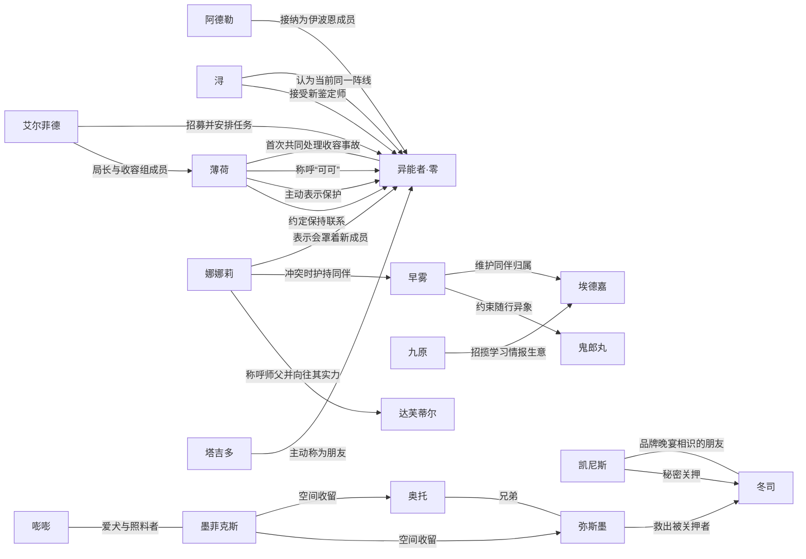

# Canon 人物关系图

> 派生审核视图；checkpoint：`nt-bv1kqoabievz-p03`（番外 月光当铺）。Canon 人物关系不等于现实用户与角色实例的 Runtime Relationship。

| 关系 | 类别 | 说明 | 证据 |
| --- | --- | --- | --- |
| 艾尔菲德 → 异能者·零：招募并安排任务 | organizational | 艾尔菲德代表管理局与异能者·零建立合作契约，并安排其参与零号异象收容及在伊波恩落脚。 | [nt-bv1kqoabievz-p01-e015](https://www.bilibili.com/video/BV1kqoaBiEVZ/?p=1&t=966)、[nt-bv1kqoabievz-p01-e016](https://www.bilibili.com/video/BV1kqoaBiEVZ/?p=1&t=1109) |
| 薄荷 ↔ 异能者·零：首次共同处理收容事故 | cooperative | 薄荷与异能者·零共同寻找R-3707的奇点并完成处置。 | [nt-bv1kqoabievz-p01-e018](https://www.bilibili.com/video/BV1kqoaBiEVZ/?p=1&t=1220)、[nt-bv1kqoabievz-p01-e024](https://www.bilibili.com/video/BV1kqoaBiEVZ/?p=1&t=1654)、[nt-bv1kqoabievz-p01-e026](https://www.bilibili.com/video/BV1kqoaBiEVZ/?p=1&t=1898) |
| 薄荷 → 异能者·零：称呼“可可” | social | 薄荷按闻到的香味给人取称呼，并将异能者·零称为“可可”。 | [nt-bv1kqoabievz-p01-e014](https://www.bilibili.com/video/BV1kqoaBiEVZ/?p=1&t=867) |
| 薄荷 → 异能者·零：主动表示保护 | protective | 第一次共同执行收容任务时，薄荷主动表示会保护异能者·零，并在交战中提醒其避险。 | [nt-bv1kqoabievz-p01-e018](https://www.bilibili.com/video/BV1kqoaBiEVZ/?p=1&t=1220)、[nt-bv1kqoabievz-p01-e025](https://www.bilibili.com/video/BV1kqoaBiEVZ/?p=1&t=1860) |
| 浔 → 异能者·零：认为当前同一阵线 | cooperative | 面对艾尔菲德的担忧，浔认为异能者·零虽然特殊，但至少当前与管理局站在一起。 | [nt-bv1kqoabievz-p01-e028](https://www.bilibili.com/video/BV1kqoaBiEVZ/?p=1&t=2025) |
| 艾尔菲德 → 薄荷：局长与收容组成员 | organizational | 艾尔菲德向薄荷下达重新收容R-3707及护送异能者·零前往伊波恩的任务。 | [nt-bv1kqoabievz-p01-e017](https://www.bilibili.com/video/BV1kqoaBiEVZ/?p=1&t=1149)、[nt-bv1kqoabievz-p01-e027](https://www.bilibili.com/video/BV1kqoaBiEVZ/?p=1&t=1968) |
| 阿德勒 → 异能者·零：接纳为伊波恩成员 | organizational | 阿德勒为异能者·零安排住处和生活用品，并正式欢迎他成为伊波恩的一员。 | [nt-bv1kqoabievz-p02-e009](https://www.bilibili.com/video/BV1kqoaBiEVZ/?p=2&t=1099)、[nt-bv1kqoabievz-p02-e010](https://www.bilibili.com/video/BV1kqoaBiEVZ/?p=2&t=1303) |
| 浔 → 异能者·零：接受新鉴定师 | organizational | 浔接受异能者·零作为伊波恩的鉴定师，并把他的到来视为店铺转机。 | [nt-bv1kqoabievz-p02-e008](https://www.bilibili.com/video/BV1kqoaBiEVZ/?p=2&t=927)、[nt-bv1kqoabievz-p02-e020](https://www.bilibili.com/video/BV1kqoaBiEVZ/?p=2&t=3773) |
| 塔吉多 → 异能者·零：主动称为朋友 | social | 塔吉多得知异能者·零能理解自己的话后，立即表示喜欢鉴定师并把他当作朋友。 | [nt-bv1kqoabievz-p02-e006](https://www.bilibili.com/video/BV1kqoaBiEVZ/?p=2&t=535) |
| 薄荷 → 异能者·零：约定保持联系 | social | 薄荷护送异能者·零到伊波恩后，嘱咐同伴照顾他并请他常与自己联系。 | [nt-bv1kqoabievz-p02-e009](https://www.bilibili.com/video/BV1kqoaBiEVZ/?p=2&t=1099) |
| 娜娜莉 → 异能者·零：表示会罩着新成员 | protective | 初次见面时娜娜莉主动表示以后会罩着异能者·零。 | [nt-bv1kqoabievz-p02-e008](https://www.bilibili.com/video/BV1kqoaBiEVZ/?p=2&t=927) |
| 奥托 ↔ 弥斯墨：兄弟 | family | 弥斯墨称奥托为「我哥」；漫画作者将当铺接待者描述为双生兄弟。 | [nt-bv1kqoabievz-p03-e012](https://www.bilibili.com/video/BV1kqoaBiEVZ/?p=3&t=2192)、[nt-bv1kqoabievz-p03-e021](https://www.bilibili.com/video/BV1kqoaBiEVZ/?p=3&t=4246)、[nt-bv1kqoabievz-p03-e023](https://www.bilibili.com/video/BV1kqoaBiEVZ/?p=3&t=5058) |
| 凯尼斯 ↔ 冬司：品牌晚宴相识的朋友 | social | 冬司称两人相识于品牌晚宴，并将凯尼斯称为一位朋友；其后出现绑架冲突，不能把这层称呼解读为目前仍互相信任。 | [nt-bv1kqoabievz-p03-e021](https://www.bilibili.com/video/BV1kqoaBiEVZ/?p=3&t=4246) |
| 凯尼斯 → 冬司：秘密关押 | adversarial | 冬司说明凯尼斯误以为其已使用香炉，担心自己反悔夺回代价的打算泄露，将冬司秘密关押。 | [nt-bv1kqoabievz-p03-e018](https://www.bilibili.com/video/BV1kqoaBiEVZ/?p=3&t=3462)、[nt-bv1kqoabievz-p03-e021](https://www.bilibili.com/video/BV1kqoaBiEVZ/?p=3&t=4246) |
| 弥斯墨 → 冬司：救出被关押者 | protective | 冬司感谢弥斯墨搭救；弥斯墨表示是因冬司的代价未到账而外出确认。救援事实不等于与冬司建立长期亲密关系。 | [nt-bv1kqoabievz-p03-e021](https://www.bilibili.com/video/BV1kqoaBiEVZ/?p=3&t=4246) |
| 九原 → 埃德嘉：招揽学习情报生意 | organizational | 九原询问埃德嘉是否考虑跟自己学习这门生意，早雾当场反对；不表明埃德嘉接受邀请或离开伊波恩。 | [nt-bv1kqoabievz-p03-e008](https://www.bilibili.com/video/BV1kqoaBiEVZ/?p=3&t=1436) |
| 早雾 → 埃德嘉：维护同伴归属 | protective | 面对九原的招揽，早雾明确说埃德嘉不会离开伊波恩，并要求九原不要再打他的主意。 | [nt-bv1kqoabievz-p03-e008](https://www.bilibili.com/video/BV1kqoaBiEVZ/?p=3&t=1436) |
| 娜娜莉 → 早雾：冲突时护持同伴 | protective | 娜娜莉担心早雾独自吃亏，见到其与当铺接待者冲突便上前要求对方不准欺负早雾；随后听取埃德嘉对现场的澄清。 | [nt-bv1kqoabievz-p03-e020](https://www.bilibili.com/video/BV1kqoaBiEVZ/?p=3&t=4106) |
| 娜娜莉 → 达芙蒂尔：称呼师父并向往其实力 | social | 娜娜莉在许愿时称达芙蒂尔为师父，希望变得和她一样厉害；只记录称呼与敬慕，不确定正式师徒安排。 | [nt-bv1kqoabievz-p03-e016](https://www.bilibili.com/video/BV1kqoaBiEVZ/?p=3&t=2790) |
| 嘭嘭 ↔ 墨菲克斯：爱犬与照料者 | other | 嘭嘭自述将蒲公英捡回家并长期照料，走失后持续寻找；本番外两者重逢，奥托明确说明蒲公英就是墨菲克斯。 | [nt-bv1kqoabievz-p03-e011](https://www.bilibili.com/video/BV1kqoaBiEVZ/?p=3&t=2028)、[nt-bv1kqoabievz-p03-e013](https://www.bilibili.com/video/BV1kqoaBiEVZ/?p=3&t=2405)、[nt-bv1kqoabievz-p03-e022](https://www.bilibili.com/video/BV1kqoaBiEVZ/?p=3&t=4645)、[nt-bv1kqoabievz-p03-e023](https://www.bilibili.com/video/BV1kqoaBiEVZ/?p=3&t=5058) |
| 墨菲克斯 → 奥托：空间收留 | cooperative | 奥托说明蒲公英收留他与弥斯墨，允许二人暂时使用自己的空间；奥托感谢这半年多的陪伴。 | [nt-bv1kqoabievz-p03-e022](https://www.bilibili.com/video/BV1kqoaBiEVZ/?p=3&t=4645)、[nt-bv1kqoabievz-p03-e023](https://www.bilibili.com/video/BV1kqoaBiEVZ/?p=3&t=5058) |
| 墨菲克斯 → 弥斯墨：空间收留 | cooperative | 奥托说明蒲公英收留兄弟二人；嘭嘭感谢他们照料蒲公英，弥斯墨在分别时提醒主人看紧它。 | [nt-bv1kqoabievz-p03-e022](https://www.bilibili.com/video/BV1kqoaBiEVZ/?p=3&t=4645)、[nt-bv1kqoabievz-p03-e023](https://www.bilibili.com/video/BV1kqoaBiEVZ/?p=3&t=5058) |
| 早雾 → 鬼郎丸：约束随行异象 | other | 早雾在本次调查中命令鬼郎丸不准乱吃、盯紧门、吐出吞下物件并禁食；后续冲突中鬼郎丸询问吞食对手需其批准。仅支持本次指令关系。 | [nt-bv1kqoabievz-p03-e010](https://www.bilibili.com/video/BV1kqoaBiEVZ/?p=3&t=1856)、[nt-bv1kqoabievz-p03-e014](https://www.bilibili.com/video/BV1kqoaBiEVZ/?p=3&t=2476)、[nt-bv1kqoabievz-p03-e020](https://www.bilibili.com/video/BV1kqoaBiEVZ/?p=3&t=4106) |
